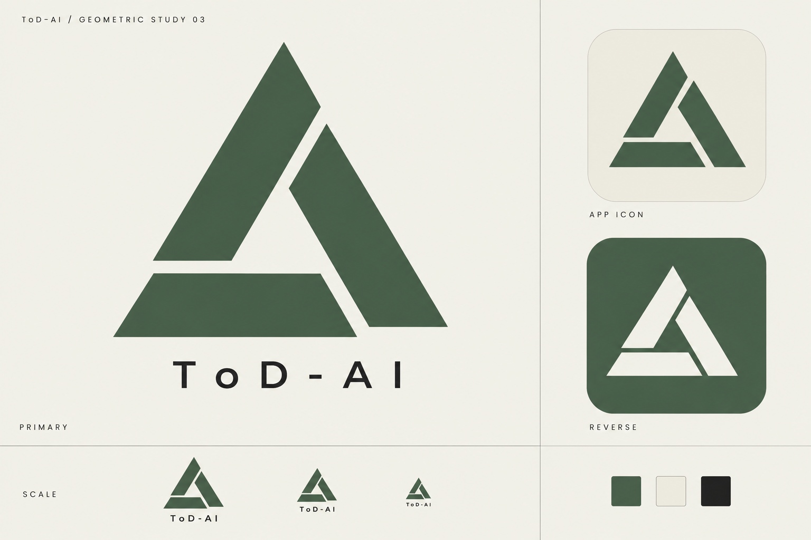

# ToD-AI 几何 Logo · 03

2026-10-22 · 用户已选定本方案，要求深色图标居中并补入通用组件。可复用实现见 [Logo.tsx](../../components/Logo.tsx)，精确几何见 [SVG 母版](../../components/assets/logo.svg)，规范见 [组件说明](../../components/README.md)。下图保留为原始概念参考，实际深浅版本使用同一矢量画布居中。



## 三角构架

以三块切角几何构件构成整体三角轮廓，中央留出开放的三角空间。断口与错位形成方向感；苔绿、暖白与墨色延续现有设计系统的科研机构气质。该方案重新设计主体形状，前两版保留用于比较。

动效已在组件中实现：三个构件位移不超过 3px 后归位，总时长 240ms，显式启用时仅入场播放一次；减少动态效果时直接显示静态图。尚未替换安装图标。

本文件为 PNG 概念提案；正式使用前需统一矢量母版和光学校正，图板内的小尺寸示意不作为实际像素尺寸验收。

## 生成记录

使用内置 image_gen 全新生成，非 CLI，没有引用前两版图像。完整提示词：

```text
Use case: logo-brand.
Design a completely NEW original geometric logo for "ToD-AI", an AI gateway desktop application. A fresh design, not a revision of a letter D logo. The user wants triangular geometry and a Rhine Lab / Arknights-inspired calm scientific institution aesthetic.

ART DIRECTION: an elegant TRIANGULAR INSTRUMENT emblem. Three substantial, precise, asymmetric polygonal plates arranged around a generous triangular negative-space aperture. Overall silhouette is an upright equilateral triangle with deliberately interrupted corners and one offset opening, like an abstract precision optical instrument or architectural research insignia. Use only three flat solid geometric parts, consistent thickness and clean 60-degree angles. Visual tension from careful gaps and one asymmetric cut. The mark must be distinctive, calm, authoritative, beautifully balanced and readable small. Do not force letters into it. No enclosing D shape. No triangle sitting inside a letter. Absolutely no play button, recycling arrows, biohazard, radiation symbol, generic AI spark, circuitry or copied Rhine Lab emblem.

PALETTE: moss green #425C4B mark on warm ivory #F2F1E9. Ink #242B28 typography. Flat uniform colors, sharp vector-like edges. No texture, shading, gradients, glow or 3D.

DELIVERABLE: one polished landscape brand concept board with generous whitespace and impeccable Swiss editorial typography. Left two thirds: a single very large hero symbol with "ToD-AI" in modest widely tracked modern sans serif below, much smaller than symbol. Upper-left small caption "ToD-AI / GEOMETRIC STUDY 03". Right third: a flat warm-ivory rounded-square app icon displaying the EXACT SAME symbol, and an inverse white-on-moss-green tile below it. Thin grid rules divide sections. Bottom narrow strip: exactly same logo at three smaller sizes, plus three tiny palette squares. Labels only "PRIMARY", "APP ICON", "REVERSE", "SCALE". All applications MUST use the identical geometry. No elaborate construction diagrams, no fake technical measurements. Show only ONE considered logo design. Prioritize a striking simple silhouette and optical balance.
```
