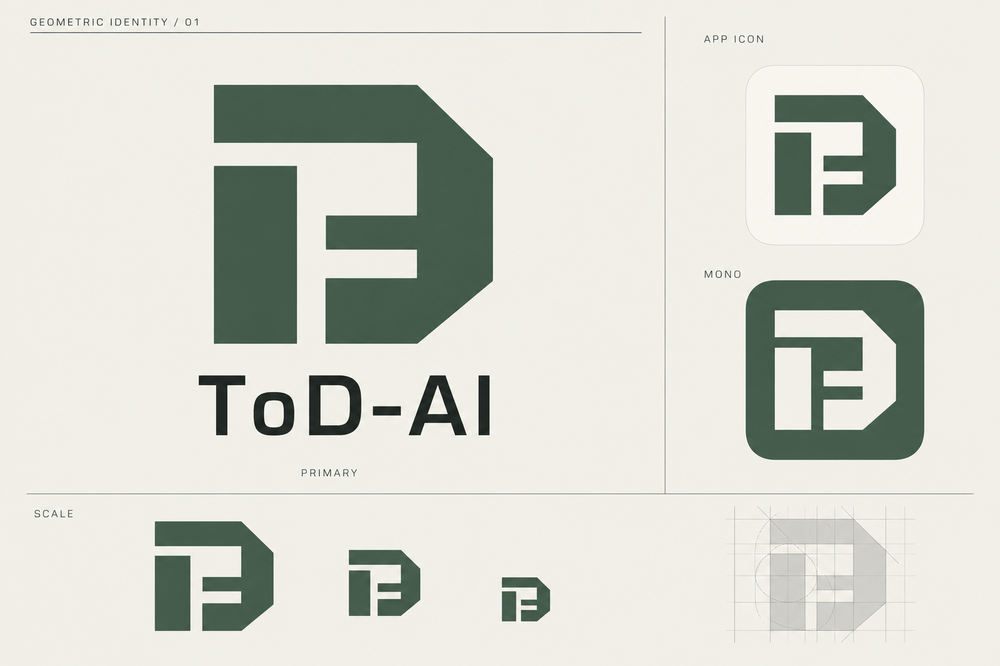

# ToD-AI 几何 Logo · 01

当前选定方案为[第三版「三角构架」](./GEOMETRIC-V3.md)，已实现为[通用 Logo 组件](../../components/Logo.tsx)，深浅图标共用居中的 SVG 母版。本页保留为第一版探索记录。

2026-10-22 · 新标志概念稿，待用户评审。

## 设计方向

「接口之门」：用厚实的几何块面、切角外框和留白通道，组合抽象的 T / D。形体呼应网关的连接与通行，视觉延续莱茵生命方向的科研机构感、理性排版与克制配色。

- 主色：苔绿 `#425C4B`；底色：暖白 `#F2F1E9`；文字：墨色 `#242B28`。实际栅格稿颜色仅作视觉参考，正式矢量资产须使用这些精确值。
- 主标志采用单色块面；不依赖细线、阴影或色彩才能辨认。
- 图板展示主标志、App 图标、反白和缩小效果。图板中的重复图形是生成示意，最终应从同一矢量母版导出，不能各自裁切作为生产图标。
- 产品名保持 **ToD-AI**。本稿探索新的独立几何标志，没有使用莱茵生命原标志。

## 品牌动效提案

与现有组件动画保持克制：首次出现时，两个主体块面沿通道方向从相距 3px 的位置归位，同时透明度从 0 到 1；总时长 240ms，使用 `cubic-bezier(.2,0,0,1)`。只播放一次，不旋转、呼吸或循环扫描，不承担同步进度或成功提示。系统减少动态效果时直接显示最终静态形态。原生安装与托盘图标保持静态。

这部分是动效设计要求，尚未制作矢量动画。当前交付为 PNG 概念图，未替换应用安装图标、托盘或现有组件。

## 生成记录

工具：内置 `image_gen`，非 CLI。生成提示词完整保存在 [PROMPT.md](./PROMPT.md)。
