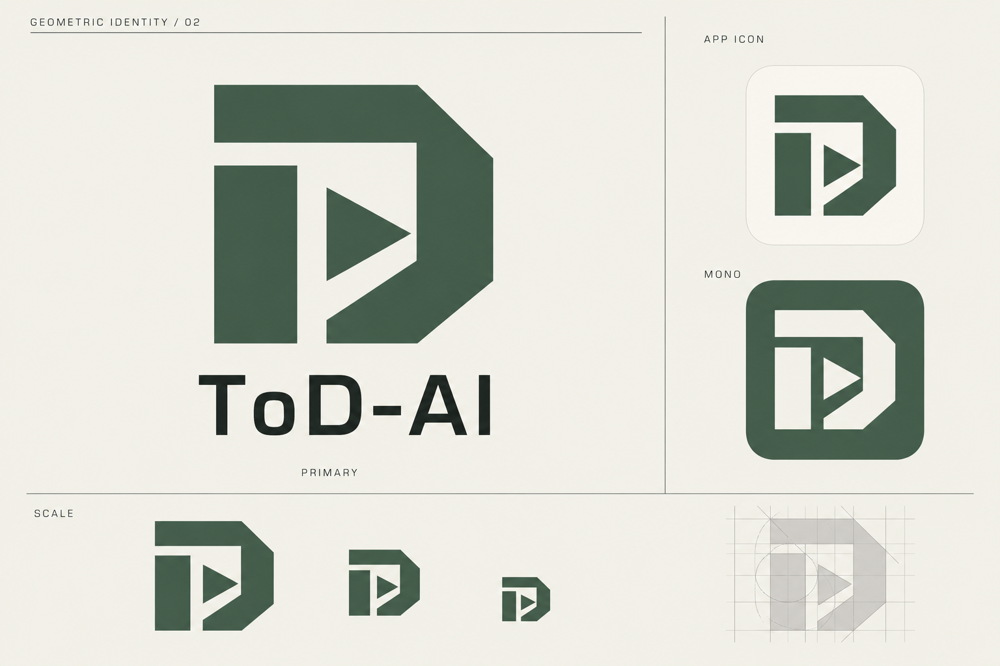

# ToD-AI 几何 Logo · 02 三角形

2026-10-22 · 按用户「加入三角形元素」要求更新的概念稿。



保留暖白、苔绿、切角外轮廓和抽象 T / D，将中心阶梯结构改为三角形核心与斜向留白通道。主标志、App 图标、反白和缩小效果同步展示。第一版保留用于比较。

动效方向沿用 [品牌说明](./README.md)：240ms 单次归位；三角形作为独立块面随主体归位，不循环旋转，减少动态效果时静态显示。这仍是 PNG 概念稿，未替换 App 资产，也未实现品牌动画。

## 生成记录

使用内置 image_gen 编辑第一版，非 CLI；输入为 `tod-ai-geometric-concept-v1.png`，不透明背景。完整提示词：

```text
Edit the supplied ToD-AI logo identity board to create version 02 by incorporating a clear TRIANGLE element into the actual logo geometry. Preserve the existing warm ivory #F2F1E9, moss green #425C4B, ink #242B28 palette, minimalist scientific-institutional Rhine Lab-inspired aesthetic, landscape board grid, exact brand text "ToD-AI", and primary/app icon/mono/scale presentation. Keep the bold chamfered outer portal shape and abstract T/D character of the mark recognizable, but redesign its stepped central negative-space channel into a clean, deliberate triangular aperture or triangular wedge integrated into the central structure. The triangle must be clearly visible at small sizes and feel structurally integral, not an added small decorative badge. One strong triangular motif only; avoid play-button logo, recycling triangle, generic AI sparkle, shields, or excessive detail. Use consistent large geometric masses and generous gaps. Repeat EXACTLY the same revised silhouette in every primary, app-icon, inverse and small-size example and in construction grid. Header becomes "GEOMETRIC IDENTITY / 02". Keep the board restrained, crisp flat vector-like shapes, no gradients, no glow, no 3D, no textures. This is an edited concept board, not production SVG.
```
