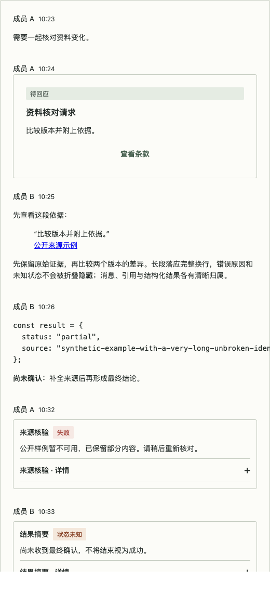
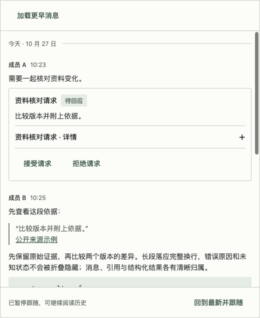
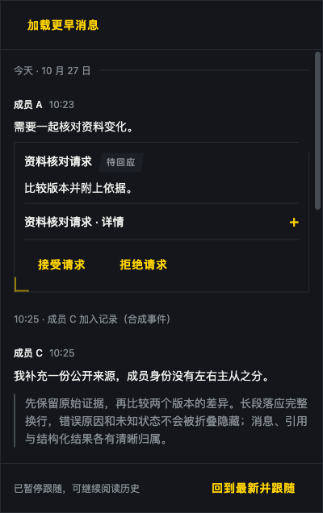
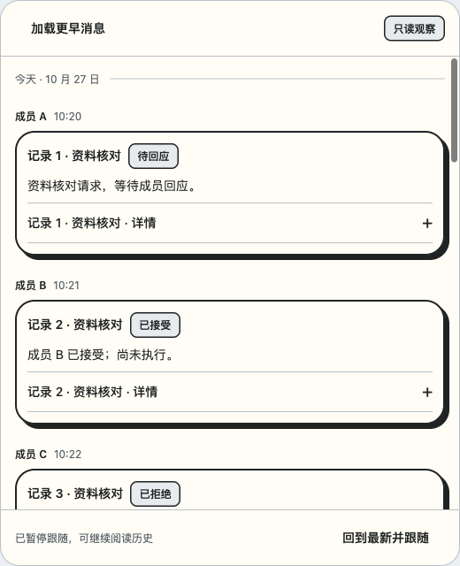

# Agent Chat 验证记录

关联 #43；2026-10-27，Asia/Shanghai。纯合成数据，没有业务 API、模型调用或消费迁移。源码候选不包含于冻结的 0.11.0 发布制品；合并不代表 npm 发布。

## 视觉对照

同一合成资料核对对话，520px 容器。之前复现 issue 的重复作者/时间、标题和状态分层及宽动作；之后合并连续作者，正文轻量，状态紧随卡片标题，动作左对齐。截图显示各自开头，长记录通过滚动阅读；不是消费产品截图。

| 问题结构复现 | 规范组合 |
| --- | --- |
|  |  |

| 战术主题 · 多成员事件 | 橙趣主题 · 只读记录 |
| --- | --- |
|  |  |

## 证据与范围

运行实现修订 `e7806fcfb646309cc3f70a9d0670bbc4f5668737`（基线 `4d70e73`），Node 24.21.0、React 19.3.1、Vite 8.3.4；Chromium 155 / macOS 的独立 Playwright 会话。随后 rebase 到 `5d9eec1` 保留导航行操作，聊天运行文件内容不变；证据文档/截图提交不改变运行实现；最终 head、制品摘要和 CI 在 PR #51 中绑定。原始本地证据 `output/playwright/` 不直接公开（可能含本机工具路径）；此文与 PR 仅保留脱敏摘要。

- PASS：Node 24 下 `npm run check`，302 项测试通过，包含 Vitest、类型、生产构建、CSS/SVG 产物检查、两个评审示例构建和包清单检查。
- PASS：三主题 × 400/520/880 容器设置 × 三场景 × 100%/200% **CSS zoom**，54 组量测与截图；另检查 400/520/880 浏览器视口。正文 14px / 22px，卡片内距 12px，正文无横向溢出。放大时容器按可用空间缩窄，不假称仍有 880px 可用宽度。
- PASS：普通/系统减少动态/手动减少动态，三主题下 200% CSS zoom 键盘 Enter 开合、焦点保留、完整详情可读。
- PASS：上翻后到达消息不跳底，加载历史保留同一消息和相对偏移（误差阈值 2px），加载按钮焦点保留；显式恢复跟随回到底部。真实可见流式正文增长时保持跟随；PageUp 暂停，流式增长同时 prepend 保留锚点。
- PASS：观察模式无接受/拒绝/发送/重试；错误和未知文字在折叠外可见；历史失败保留并可重试；取消/连接失败保留内容且无迟到更新；自然结束为部分结果。卸载断开 ResizeObserver、清理流式与历史计时器。
- PASS：公开包入口独立安装消费与生产构建、真实浏览器操作；268 个安装文件逐一核对相同；示例仅登记成员、内容、状态与允许动作。
- SKIPPED：浏览器原生网页缩放、屏幕阅读器真人朗读、其他浏览器引擎、超大记录虚拟化；不以 CSS zoom、DOM 语义或 Chromium 结果外推。#43 要求的 CSS zoom 与键盘矩阵已单列。
- N/A：业务权限、真实模型、后端分页、iOS、消费产品升级、npm 发布。

## 保留的失败与修正

1. 首次全量检查的测试辅助函数返回宽联合类型，导致 TypeScript 不接受消息 actions；收窄为 ChatMessage 后通过。单元测试通过不等于类型检查通过。
2. 首次视觉检查发现 Surface 的无内距修饰覆盖 ChatCard 内距；提高 ChatCard 规则具体性后，54 组实际计算值均为 12px。
3. 首次浏览器行为脚本用完整文本精确定位 summary，但其中还有装饰符号，导致 30 秒超时。改为有作用域的 summary 定位，保留原失败；没有将定位器问题记成组件修复。
4. 实际流式交互发现仅比较末条 ID 会漏报插在流式末条之前的新消息。改为比较稳定 ID 集合、排除前插历史，补契约回归并重新验证。
5. 官方参考页有第三方资源报错；本轮只把可见页面、实际展开和官方文档作为证据，没有宣称完整参考产品运行通过。

6. 动作焦点回归发现 Button 覆盖宿主传入的 aria-disabled。补齐原生属性透传语义并阻止点击，保留忙碌/不可操作控件焦点；历史加载使用已有 busy API。

## 新增可复用结论

新消息不一定改变列表尾部 ID（例如消息插入到已有的流式记录之前）。新消息提示应比较稳定 ID，单独排除 prepend 的历史；滚动恢复也应绑定原消息与偏移，而非总高度差。该结论已通过组件回归与真实流式同时加载历史验证，不推断任意重排/虚拟化行为。
