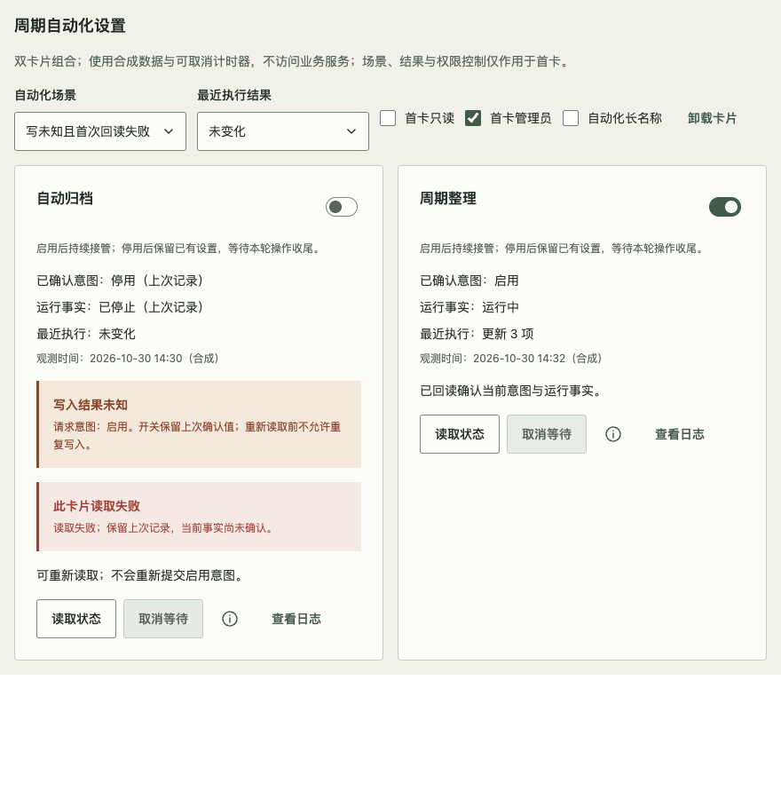

# 周期自动化设置卡片

适用于同页多个独立周期自动化的 Web 管理界面。基于现有 Surface、Switch、Text、Notice、Popover 与居中 Dialog 组合；不新增公共组件、调度器、权限或服务 API。对应 [#137](https://github.com/linhay/rhine-design/issues/137)。真实展台 `#automation-settings`，隔离入口 `?fixture=automation-settings`；这是未发布的源码配方，不代表已发布 npm 包或原消费产品已升级。

## 三种事实分别呈现

| 信息 | 所有权与显示 |
| --- | --- |
| 启用意图 | 宿主持久化事实。Switch 只显示最后确认的值；等待保存期间保持原值并常显“尚未确认”。确认保存后才切换，不能据此宣告运行或停止 |
| 运行事实 | 独立显示开始中、运行中、停止收尾中、已停止、不可用；以服务观测为准。停用意图已保存与外部操作排空是两个事实 |
| 最近执行 | 更新、未变化、跳过、失败、待确认分别显示；更新计数必须有依据。未知不补零、不当成功，错误和未知不藏在日志里 |

卡片标题已经标识对象时，可用必填字符串 label 配合 `labelVisibility="hidden"`。短说明常驻开关下方：持续接管的影响与停用后果；细则进入独立信息 Popover。状态、结果、观测时间位于内容区，底部操作区仅放操作。日志在居中 Dialog 按需阅读，关闭返回本卡日志触发器；读取日志不触发写入或执行任务。

**场景局部约束：**本例停用后保留已经产生的设置。宿主若会撤销或删除设置，必须说明真实后果，不能套用此文案。这不是所有自动化的统一语义。

停止自动管理也不等于对象已移除。仍需查看原对象历史时，按[对象生命周期配方](OBJECT_LIFECYCLE.md)区分明确移除、完整观测与过期未知；已确认全部退役且无历史需求时直接使用现有空态，移除旧读取与轮询，不为“已结束”保留卡片。

## 等待、错误与恢复

- 每卡分别持有写等待、读等待、错误、快照、请求意图和取消代次；一张卡失败或等待读取不阻塞另一张。共享设置不能错误套用此独立语义。
- 写响应丢失或取消写等待时，结果可能已在外部生效。保留最后确认值并标明“写入结果未知”和请求意图；不得自动回滚成停用、重复写入或自动重试写操作。
- 响应丢失先进行一次回读；失败后退出忙态，持续显示未知与读取错误，提供显式“读取状态”。回读成功才接受已确认意图和运行事实。即使写结果已确认，执行计数仍可能未知。
- 每次用户写入或主动读取，若返回开始中/停止收尾中，最多安排一次后续合成观测；该观察响应即使仍在过渡也不再排队。写响应丢失先回读仍保留；回读后至多一次观察。之后保留最后观测的过渡事实，由用户显式“读取状态”继续确认，不据计时器推断已运行/已停止。
- 取消仅停止本卡等待和后续观察，不承诺撤销外部操作。请求代次与 AbortSignal 同时防护；即使传输忽略 abort，旧响应也不能覆盖新快照。卸载中止等待、清除计时器，迟到结果不更新界面。
- 读失败保留旧快照和原观测时间，运行事实标注“上次记录”；无新观测不能宣告恢复。异常常显且有下一步，Toast 不能代替它。

Switch 等待或未知时使用只读语义保留焦点，宿主同时阻止写入；不可用、只读或非管理员也不可写。读取/日志权限仍由真实宿主单独判断，界面只读不等于服务鉴权。展台权限控制仅作用于首卡，第二卡用于验证隔离。

## 展台与验收边界

`preview/AutomationSettingsGallery.tsx` 与 `preview/automationSettingsRecipe.ts` 仅为宿主组合示例。合成传输使用650ms可取消响应，接受意图后模拟外部启停，再做一次有界观测；没有后台轮询、真实调度、业务服务或公共 Hook 导出。真实产品自行提供持久化、权限、幂等、事实观测与恢复策略。

回归入口：`npm test -- tests/AutomationSettings.test.tsx`；生产浏览器脚本：`scripts/check-automation-settings.js`。覆盖四主题、400/520/880局部容器、200% **CSS zoom**、长名称、Space/Tab/Escape与归焦、系统/手动减少动态、写未知回读、停用收尾、局部读取失败与权限、取消/迟到结果/卸载。检查最终候选构建和固定 tarball 全新安装，源码/JSDOM与真实布局分别记录。

该矩阵证明库的窄容器兼容，不强制桌面消费产品承担手机布局或移动端交互要求。桌面产品验实际窗口、局部容器、缩放与键盘，见 [#40 的支持范围决定](https://github.com/linhay/rhine-design/issues/40#issuecomment-6521010237)。CSS zoom 不证明原生网页缩放，合成服务不证明真实后端行为；消费端历史7项/9状态也不作为本例上游验收。

合成生产展台示例：首卡写入未知且回读失败时，第二卡仍可独立运行。截图只说明此静态状态；交互与动效由上述脚本和回归分别验证。

