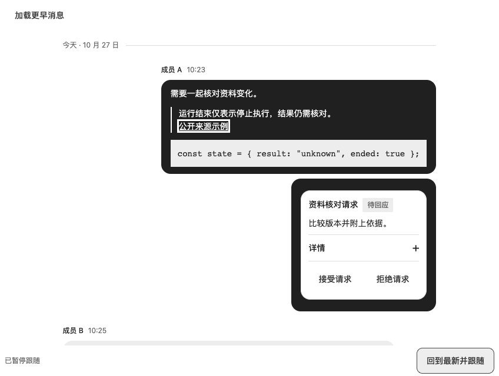
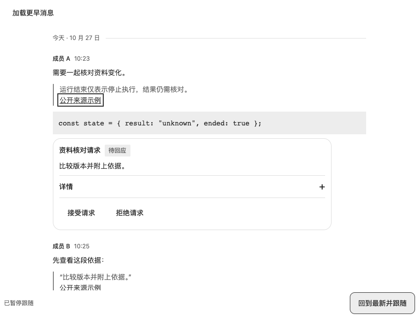
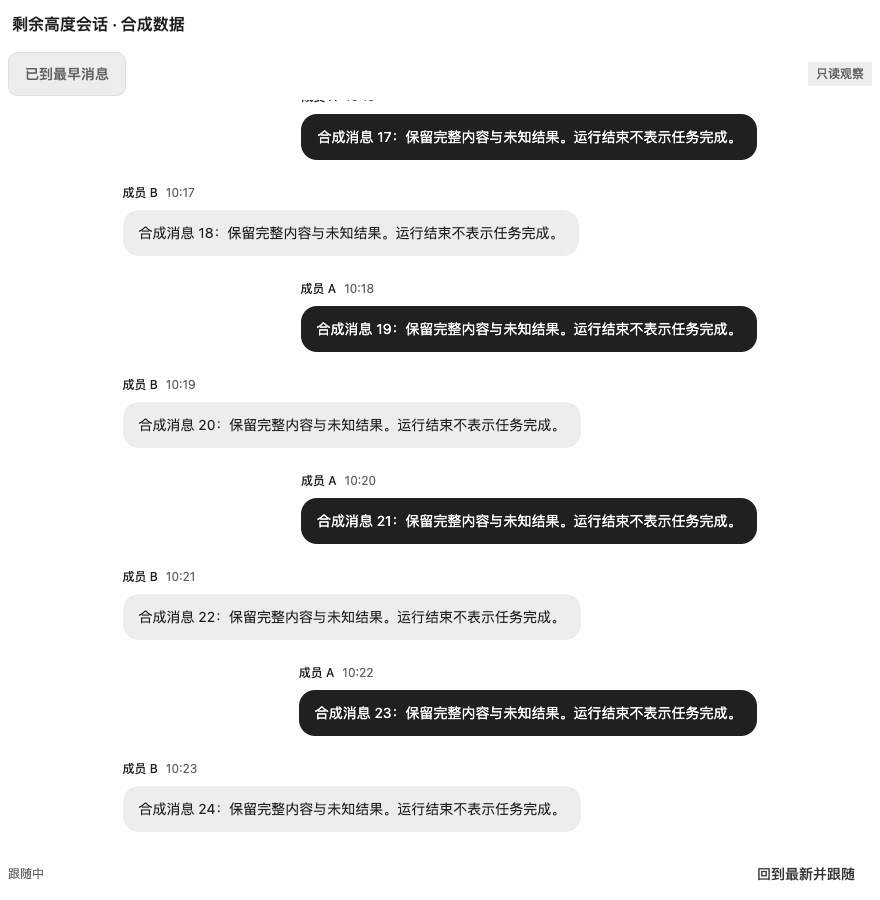

# ChatThread 全高与气泡验收（2026-10-29）

#99 是已有 #43 聊天契约的布局/外观扩展；基于 #98 合并主线 `a9e77a67a3420a4a21d22b305276e6efb8398f48`，合并时保留同期主线。Node 24、Chromium、纯合成数据。固定候选 commit、tarball SHA-256、逐文件对照与最终 CI 记录在对应 PR，源码能力尚未 npm 发布。

- PASS：单元/契约、类型、生产展台、双评审入口及包内容检查。新增稳定成员映射、默认兼容、compact 历史状态和只读操作测试；最终总数以 PR 所绑定候选为准。
- PASS：生产构建四主题 × 400/520/880 × 100%/200% CSS zoom × plain/bubble × 双成员/多人事件/只读，共 144 组合。量测有界 fill、高度填满、单一阅读滚动区、无横向溢出、末消息滚动可达、稳定成员方向与强色气泡中正文/代码/引用/链接/ChatCard 状态的实际前景背景对比度。
- PASS：真实视口宿主同四主题/三宽度/两缩放/两外观，共 48 组合。固定标题占据自身高度，ChatThread 填剩余高度；页面不能纵向滚动，内部只有一个阅读滚动容器，Home 和回到最新入口均可达。
- PASS：四主题 × 两外观的 400px / CSS zoom 2 交互。历史失败保留焦点和位置，重试 prepend 保留消息锚点，新到达不抢阅读位置，显式恢复到底，真实定时流式增长/暂停/取消后无迟到内容；只读来源 Dialog 往返归焦。系统/手动减少动态下展开、暂停和恢复路径 PASS。
- PASS：四主题默认 standalone/plain/full 的消息区仍为 512px（32rem）；RTL 逻辑 end、强色区域键盘双层 focus 边界可见。
- 定向反例：临时把 fill 视口破坏为固定 32rem。第一版只检查“不溢出”，未识别底部空隙；补充填满的末端边界断言后命中失败。正常完整矩阵与反例分别保留，不把未检出算成功。

## 保留失败与限制

首轮 typecheck 检出展台 Select 的可选联合类型断言带 undefined；改为 NonNullable 后通过。交互首轮在 PageUp 后 120ms 取锚点，浏览器键盘滚动仍在变化；后续记录滚动稳定采样（约 330–350ms）再比较，锚点偏移相同。第二轮在模态打开后才通过 role locator 读取已被隐藏的背景触发器，等待超时；改为打开前保存节点并在关闭后检查 focus。视口检查初版重复乘 CSS zoom，把已经按视口坐标报告的 document scrollHeight 放大，24 项误报；修正后另用 window.scrollTo 实测页面不能滚动。全部初始输出保留，后续通过不覆盖失败。

原生网页缩放、人工读屏、其他引擎、真实模型/后端与消费产品升级 SKIPPED。全高要求宿主确定高度并提供足够空间；任意超短容器或无限长控制状态不在本次承诺内。CSS zoom 不是原生缩放，合成流结束保持部分/未知，不推导任务完成。

脚本：`scripts/check-chat-layout.js`、`check-chat-viewport.js`、`check-chat-layout-interactions.js`、`check-chat-layout-smoke.js`；Playwright CLI 页面指向本次生产预览后运行。`?chatProbe=height` 触发高度破坏反例。必须读取 JSON 的 pass、每项结果与错误，不能只看 CLI 退出码。

本轮只交付源码 API、契约、展台与包验证。npm 发行和消费样稿替换另行授权，不是自动延伸的本轮前置条件。issue 由主控按明确源码范围判断关闭。
