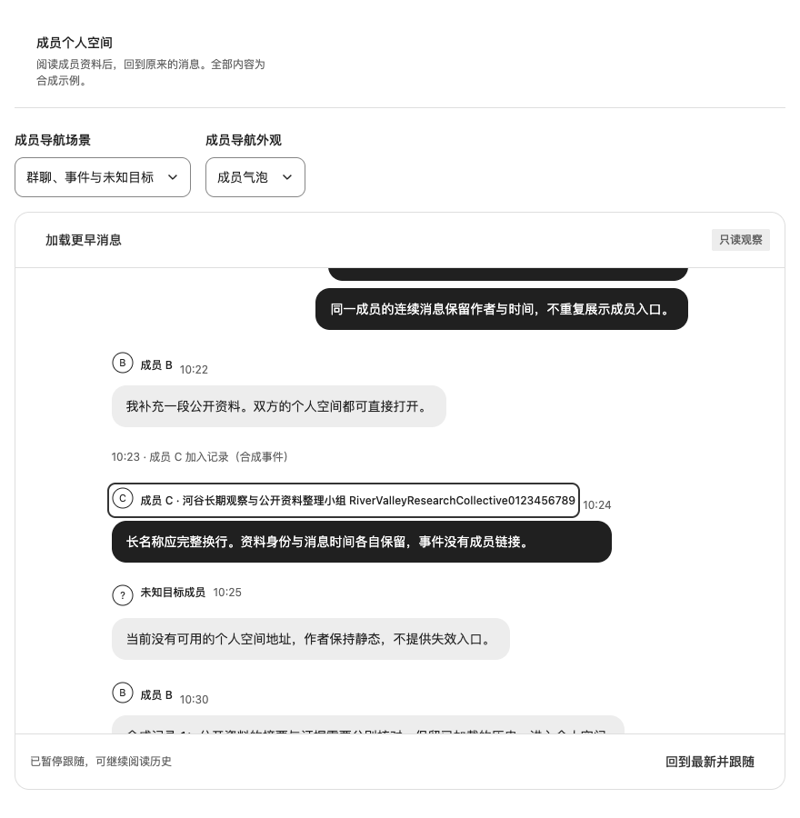
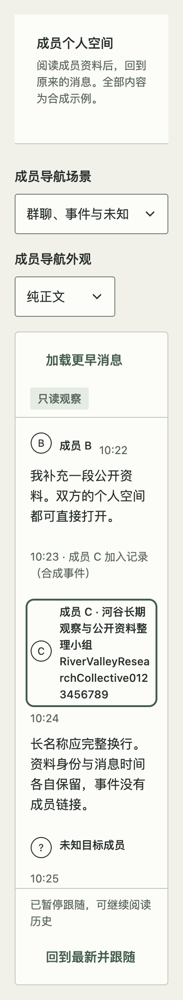
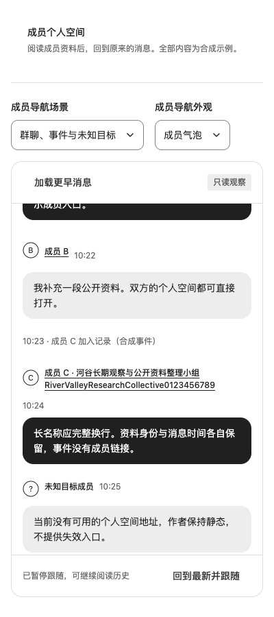

# ChatThread 成员链接验收（2026-10-30）

关联 [#110](https://github.com/linhay/rhine-design/issues/110)，基线 `2467cce1125e0d7833a513667feecd9a3aa8b0d1`。新增可选成员导航，不改变字符串身份、分组或只读动作契约。Node 24、Chromium、合成资料。精确提交、固定 tarball SHA-256、源码/安装逐文件核对和最终 CI 结果记录在关联 PR；此源码能力尚未 npm 发布。

## 检查入口与边界

- `tests/ChatMemberLink.test.tsx`：只读头像/姓名单一原生链接、时间外置、article 名称、有限公开类型、无映射静态回退、每次作者 render 单次映射、连续/事件不求值，以及普通/修饰点击未被组件阻止。JSDOM 不证明浏览器导航。
- `scripts/check-chat-member-link.js`：四主题 × 400/520/880 × 100%/200% CSS zoom × plain/bubble × 私聊/群聊，共 96 组合。核对消息区/页面横向溢出、作者逐行文字裁剪、时间独立、头像装饰语义、事件/未知目标静态、连续作者没有隐藏交互及末项可达。
- `scripts/check-chat-member-link-interactions.js`：四主题 × 两外观，在 400px/200% 下实际 Tab、Shift+Tab、Enter、可见 focus；双方和长名成员分别点头像/姓名；时间不导航；返回保存已加载历史、scrollTop 与入口焦点。保留的隐藏聊天退出键盘顺序。系统/手动减少动态走同一路径。
- 原生修饰键、中键和 `_blank` 三条路径分别创建新标签，从 href 初始化资料且不导航原聊天；粗指针环境分别核对单行 A/B 与长名 C 至少 44×44 CSS px、不与时间重叠及实际 tap 往返；静态未知作者无下划线；粗指针有常驻下划线，纯细指针保留悬停提示。主页面、新标签与触控页面均记录 pageerror。粗指针模拟不代表触屏真机验收。
- 原有 `check-chat-layout.js`、`check-chat-layout-interactions.js`、`check-chat-layout-smoke.js` 回归分组、布局、历史失败/重试、prepend 锚点、流式跟随/暂停/取消、只读来源往返、默认布局与 RTL。

脚本在打开本轮生产预览后用 Playwright CLI `run-code --filename` 执行；必须读取 JSON 的 `pass`、每项结果与 `errors`，不能只看 shell 退出码。给页面追加 `?memberProbe=clip` 或 `?memberProbe=hidden-link` 后运行布局脚本，分别在临时页面注入姓名裁剪、隐藏可聚焦链接；应明确检出目标失败。交互脚本另支持 `memberProbe=touch24`，仅运行粗指针子集并临时把链接最小目标降至24px；相同44px断言应检出短作者高度不足。`memberProbe=touch-no-cue` 则临时去掉触控下划线，应命中可辨识性断言。反例不修改正式组件。

## 本轮结果

- PASS：完整 `npm run check`（58 文件、437 测试）、类型、展台和两个评审入口构建、包清单检查。
- PASS：96 组合成员链接布局；8 组真实键盘/往返、2 种减少动态、3 种原生新标签和2种粗指针外观，页面错误为零。
- PASS：原聊天144组合布局、8组历史/流式交互与2种减少动态，四主题默认布局/RTL focus回归。
- PASS（预期失败）：姓名裁剪反例明确命中文字裁剪，隐藏链接反例明确命中连续header交互；24px最小值反例中单行作者实际为28.5px，而长名仍为108px，明确命中44px断言。原始反例结果均为 `pass:false`，不是正常矩阵失败。
- 独立复核：URL直达及标题归焦、18条已加载历史、Enter和浏览器前进/后退保持scrollTop及原作者焦点。该抽样不替代完整矩阵。

## 来源与交付

固定一次 tarball 后，在全新合成消费者安装，通过公开入口使用 ChatThread、ChatMemberLink 和主题。消费者仅复用展台宿主数据/导航，不复制组件实现；重新构建并验证对应生产入口，记录全部包文件与冻结源码、安装目录逐字节一致。旧消费候选的包摘要和断言仅作参考，不计入此上游验收。实际 PASS/FAIL/未覆盖列表以 PR 的最终候选证据为准。

原生网页缩放、人工读屏、Safari/Firefox、触屏真机与真实业务服务 SKIPPED。npm 发布和真实消费产品升级不属于本轮；宿主仍负责目标可用性、权限、持久化与完整路由生命周期。CSS zoom、Chromium 和合成历史不能外推这些能力。

首轮布局脚本在 CLI 执行环境遇到 `URL is not defined`，尚未进入断言；已保留原始失败，将 URL 构造移至浏览器上下文后另跑，不能把此工具错误记作组件回归或反例检出。

独立暂存评审发现初版粗指针检查只量多行长名，其自然高度不能证明最小目标；补测单行作者并加入上述24px最小值反例。原初版PASS仅对应原断言，最终记录以补强后的完整输出为准。

PR审阅补充：无悬停/粗指针下只靠hover无法区别链接与静态作者。根据字体契约的可辨识样式要求，仅这些环境采用姓名常驻下划线；不把此具体媒体查询提升为全库规则。原 `dd684df` 候选与制品保留为已取代证据，新修订独立打包、全新安装与复验，精确身份回填PR。

补充验证：四主题细指针的静态/悬停样式、两外观粗指针常驻提示及tap往返PASS；去掉提示的反例明确命中。二轮尺寸矩阵在生产目录同时重建期间出现3项导航HTTP失败，原记录保留，后续只对冻结的构建运行矩阵，不混写制品。

