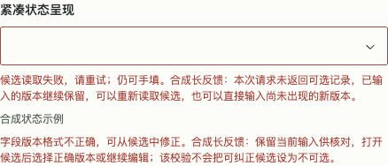

# Combobox 状态与字段校验（#115，未发布）

`Combobox` 与 `RemoteMultiSelect` 的源码新增两个可选参数；npm 0.11.3 不包含它们。默认布局与既有候选读取行为兼容。真实展台 `#forms` 的“候选状态与字段校验”可切换默认/紧凑、校验、读取、分页、禁用和只读；独立生产验收入口 `?fixture=parameter-config&combobox=states`。

| 参数 | 默认 | 语义 |
| --- | --- | --- |
| `validationError?: string` | 无 | 字段值不合法，保持可见、`role=alert`、关联输入描述及 `aria-invalid`，允许选择候选纠正。宿主决定何时校验、清除错误和接受新值。 |
| `statusDisplay?: 'default' \| 'compact'` | `default` | compact 的常规数量、读取中、空结果状态不占视觉行，仍保留 `role=status` 和输入描述；读取中与空结果在打开的弹层呈现。读取错误始终可见，即使同时 loading。 |

原 `error` 仍表示候选读取失败：禁止选择旧候选、保留手填和重试、继续设置 `aria-invalid`，不将兼容参数重新解释成字段校验。它与 `validationError` 同存时，分别呈现与描述；compact 不隐藏任一错误。默认状态的 error/loading 优先级不变；compact 为持续可见的读取错误优先。`hint` 仍是辅助说明，不能临时承载字段校验以绕过候选禁用。

```tsx
<Combobox label="统一版本" query={draft} onQueryChange={setDraft}
  value={draft} onValueChange={option => setDraft(option.value)} options={candidates}
  validationError={validationError} error={fetchError} loading={loading}
  statusDisplay="compact" onRetry={retry} />
```

数量是当前宿主返回的候选数，不是总历史数；compact 是可选密度，不能作为所有表单的默认规则。保留 label、hint、输入字号与命中范围，不添加消费方私有隐藏 CSS。IME 组合期间不查询或选择，End/Enter、Escape/Tab、disabled/readOnly 以及多选完成/分页语义保持原契约。

查询、排序、去重、180ms 防抖、请求取消和过期保护归宿主。[参数配方](PARAMETER_CONFIG.md)提供四字段独立合成观测示例；不新增公共版本引擎或真实历史接口。读取失败只影响候选，不应让手填的新版本失效；字段校验失败也不应阻止可纠正选择。

验证入口：`tests/ComboboxFeedback.test.tsx`、`tests/ParameterConfig.test.tsx`、生产浏览器 `scripts/check-combobox-feedback.js` 及参数配方既有矩阵。CSS zoom 和 DOM live region 证据不等于原生网页缩放或读屏语音验证。精确源码、固定候选和结果见关联 PR；尚未 npm 发布或替换原消费产品临时适配。

2026-10-30 源码生产验收：Node 24.21.0 / Chromium 156；四主题 × 400/520/880 × 100/200% CSS zoom 的 24 组，另加四主题 400×648 / 200% 的 4 组，合计 28 组状态矩阵 PASS。包含默认状态行、紧凑 live region/描述、两类错误与加载同存、长错误实际滚到可读、可纠正选择、失败旧候选不可选、重试与手填、IME、只读/禁用、分页和多选完成/Tab。正常、系统减少动态与手动减少动态的参数候选/非法原值纠正/逐字段重试与手填确认路径通过。真实展台另验四主题×三宽共 12 组节点/草稿保留，实际 240ms 候选响应取消及卸载后 180/240/600ms 计时器释放。新增测试在原 main 实现下 4 FAIL / 1 PASS，证明缺失能力会被检出。

原始失败保留：首次角色查询把原生 Select 的 option 计入候选；多选完成后 Tab 合法到已选标签动作时，被原断言误判为滞留；CLI 沙箱不可直接构造 URL。修正检查没有据此修改产品计时器或候选语义。DOM/live region 不证明读屏实际播报；原生网页缩放、其他引擎与真实服务 SKIPPED。候选包、全新消费者结果、最终 head 与合并阶段以本轮 PR 的固定回执为准。


