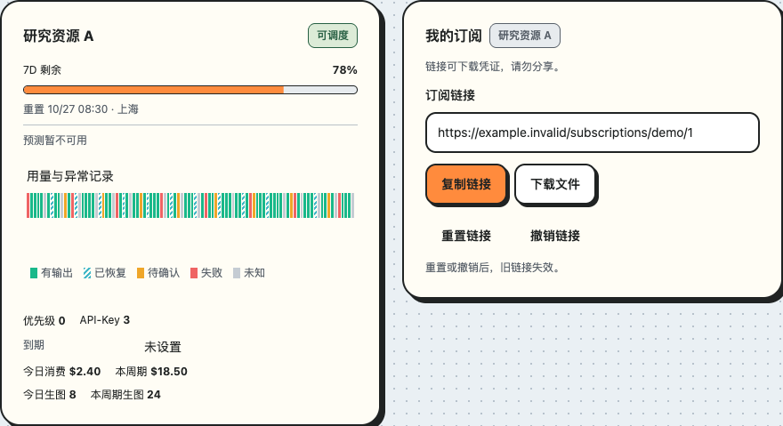

# 紧凑摘要与凭证操作

对应 [issue #14](https://github.com/linhay/rhine-design/issues/14)。本页的 `ButtonLink`、`StatusTimelineList` 与 `TimelineLegend` 扩展自 npm 0.8.0 提供，0.6.0 不包含；使用前核对实际导出并固定消费版本。真实展台：`/#compact-account`。

## 从用户任务开始消融

先确定用户现在要识别什么、判断什么、执行什么，再选择常显信息。接口返回多少字段不决定界面有多少行。优先保留对象身份、当前有效读数、可执行动作、未知/失败与影响当前决策的后果；机制说明、重复状态和低频记录退出首屏。

每次删减都说明为何不影响任务，并验证反例：链接框与复制/下载已表达“有链接”，无需再堆叠“当前链接”和“已生成”；读取失败、无链接与操作结果未知仍须分别呈现。历史记录有内容时按需展开，空历史不占一块常驻区域。生成时间可进入记录，不能把时间本身删除或改成其他语义。

短风险提示放在相关动作附近。例如“链接可下载凭证，请勿分享。”持续可见；“重置或撤销后，旧链接失效。”紧邻管理入口。客户端如何轮询、接口如何返回，不是用户取得链接所需的首屏信息。若机制影响当前动作或恢复路径，则保留其具体后果，不能用消融隐藏失败或撤销边界。不展示与当前选择无关的技术徽标来代替用户可行动的提示。

## 只读摘要使用无框组合

外层 `Surface` 已定义对象边界时，内部额度摘要不再包细线圆角框。进度、剩余额度、重置时间与预测状态通过 `Progress`、`Text`、`Inline` 和 `Stack` 组合，必要分区使用 `Divider`；不能移除未知或预测失败的文字。

事实按共享维度配对：基础信息把优先级、密钥数量与账号到期排列在同一行，窄卡片中到期独占一行；订阅到期独立呈现。今日和本周期占两个稳定等宽列，消费与生图按行对齐。复用 `Grid`、`Inline`、`Stack` 和 `Text`，不把每个字段装成胶囊或小卡片，也不混用不同的标签列宽。压缩来自移除装饰、重复标签和无意义空白，不减小业务字号、不裁切数字、不固定高度。保留双成本的顺序和含义、未知 `—` 与真实 `0`，不相加或相互替换。长内容和 200% 缩放允许自然增高。

列表分类同排动作、只读归属单行滚动和内容区紧凑日期见[列表卡片组合配方](LIST_CARD_RECIPES.md)。这是局部组合偏好，不新增公共组件。

## 只读工作台的局部组合（#14）

在已有可分割窗格的只读工作台中，外层 `Surface` 定义唯一容器边界，内部页面使用具名语义 `section`，不再叠加同用途卡片和内距。标题、实际状态、显式刷新与低频窗格 `Menu` 置于同一头部行；窄容器允许按组换行，不能固定单行裁切标题或操作。`Inline` 的标题/动作与换行规则见[间距组合](../components/SPACING.md#卡片标题与局部指标切换)。产品已有的标题动作插槽由宿主组合，不新增通用多窗格管理器或插槽 API。

主要内容（画面、树、结果）优先，任务、目标、暂停、unknown/partial、失败及恢复路径仍常显。低频设置和来源说明放在相关标签旁的公开 `Popover`，低频标识与证据放入 `Disclosure`；不能把影响当前判断的不完整/失败状态藏进去。少量路径记录可用 `Stack` / `Inline` / `Disclosure` 保留完整状态、源 ID 与可复制命令，不为它们强套固定最小宽度的 `DataTable`，也不因此改变 DataTable 的默认值。共享的机制说明原则见[通用规范](DESIGN_SYSTEM.md#2-通用原则)。

这是[匿名消费成功实践](https://github.com/linhay/rhine-design/issues/14#issuecomment-6515899375)的限定接纳，适用于该类已有窗格的只读组合；不将单个产品的高度收益推广为普遍指标，也不宣称已消费尚未发布的 ResponsiveActions。常驻树的焦点、快照、画布联动和生命周期继续遵守[常驻树配方](RESIDENT_TREE.md)，本节不改变其默认展台布局或新增组件。接回真实宿主时核对主题、窄容器/长文、键盘、浮层关闭归焦、必要状态和资源释放；文档接纳不等于该宿主已完成验收。

## ButtonLink：具有按钮外观的原生链接

```tsx
<ButtonLink href="/files/example.json" download="example.json"
  variant="secondary" target="_blank" rel="noreferrer">
  下载文件
</ButtonLink>
```

`ButtonLinkProps` 包含必填 `href: string`、原生 anchor 属性、`variant: primary | secondary | quiet | danger`、`disabled`、`busy`、`busyLabel`，支持 anchor ref。与 `Button` 复用同一视觉体系。默认 variant 为 primary；同一组动作通过任务优先级选择 variant，不因 HTML 元素不同而降低视觉权重。

- 可用时是真实 `<a href>`：Enter 激活，修饰键、右键、`download`、`target` 与 `rel` 由浏览器处理；不设置 `role="button"`，不模拟 Space 按钮行为，不命令式导航。
- `disabled` 移除 href、设置 `aria-disabled` 与 `tabIndex=-1`，阻止主/辅助点击；原生 anchor 没有 `disabled` 属性。
- `busy` 移除 href 并阻止重复激活，但保留焦点和 Tab 位置，设置 `aria-busy` / `aria-disabled`；原文字占位、spinner 与 busyLabel 遵循 Button。
- 原生 capture 事件仍先于组件拦截运行。业务动作使用 `onClick` / `onAuxClick`，capture 仅用于观测；不要在 capture 内绕过禁用状态。
- 组件只管理可交互语义。宿主负责同源/目标路径校验、权限、请求生命周期与结果，不把历史失效链接传成可用下载。

## 一行图例，按需查看规则

```tsx
<TimelineLegend label="历史状态图例" compact items={[
  { status: 'healthy', label: '有输出', description: '有已确认输出；当前证据未发现异常，不代表完整可用性。' },
  { status: 'recovered', label: '已恢复', description: '本时段曾异常，后续重试已有成功证据。' },
  { status: 'degraded', label: '待确认', description: '存在异常，但最终结果证据不足。' },
  { status: 'failed', label: '失败', description: '存在已确认的最终失败。' },
  { status: 'unknown', label: '未知', description: '缺少记录或证据不完整，不能解释为健康。' },
]} />
```

`TimelineLegendProps` 为 `label?: string`、`compact?: boolean`、`density?: 'default' | 'compact'`（密度参数未发布）、`items?: TimelineLegendItem[]`；item 为 `status: TimelineStatus`、`label: string`、`description?: string`。每种 status 在一组中唯一。以上规则仅为合成示例，宿主必须传入自己的实际证据定义，组件不推断健康评分。

默认无参调用仍显示原五类完整标签。`compact` 把项目保留在一行；容器过窄时仅图例局部横向滚动，不使页面溢出。有 description 的项目可鼠标悬停、键盘聚焦或触屏点按查看，操作区域至少 44px；一次只开一项规则。Enter/Space 从触发器进入详情关闭按钮，Escape 关闭并按需要归还焦点。没有 description 的项目保持只读文本，不制造空交互。

键盘焦点位于图例触发器，或当前规则浮层内持有焦点时，其他项的悬停不能切走正在阅读的规则；自动滚动可能把其他按钮移到静止指针下，这不代表用户主动切换。显式点击仍可选择另一规则，焦点离开该组后恢复通常的悬停行为。

Escape 卸载规则到触发器归焦之间的短暂 body 焦点同样保留键盘操作归属，不能被静止指针重新打开规则。真正聚焦外部控件、显式指针按下或窗口失焦会释放该归属，不靠固定延时屏蔽悬停。

`StatusTimelineList` 负责稳定行身份与详情互斥，公共契约见[应用组件](APPLICATION_COMPONENTS.md)。时间窗口、统计范围、unknown/partial/error 与实际业务判定仍由宿主保留；短标签不改变详情证据。

列表末项不叠加行间距：最后一项底部为零，列表仅保留 8px 操作余量，容纳 28px 时间条外延的 44px 命中区。与 `Stack gap={1}` 的图例组合时，时间条到图例容器的间距为 12px，不能靠宿主负 margin 或缩小命中区压缩。多条列表中间仍保留分隔留白。此修正及事实列对齐由 [issue #23](https://github.com/linhay/rhine-design/issues/23) 跟踪，自 0.9.1 提供；使用前核对实际安装版本。

时间轴与图例的浮层内部归一化定位包装层的祖先 CSS zoom，正文保留等效缩放与视口内滚动。此修复仅覆盖这两类详情，不宣称其他浮层已支持主题根 CSS zoom；浏览器原生网页缩放与 CSS zoom 是不同的证据。跨卡鼠标移走后延迟关闭，并允许移入详情继续阅读；键盘焦点和触屏操作不被鼠标离开逻辑打断。

## 验收边界

展台覆盖三主题、400/520/880 宽度、200% 缩放、长值/双成本/零值/未知、可选到期、loading/error/no-link/历史展开、原生下载语义、图例鼠标/键盘/触屏入口。界面仅使用合成数据；库测试和浏览器样机不证明消费方鉴权、真实下载或生产接口通过。

### 2026-10-24 源码候选验证

- Node 24：164 项测试、类型检查、构建与资源门禁通过。
- Chromium：30 个内容布局组合（18 个三主题/三宽度/100–200%组合，加12个400px/200%订阅状态组合）、79 条行为断言通过。有效零值、未知、长双成本、两种到期、历史展开、触屏、键盘及复制失败保留链接均得到检查。
- 9 组局部内容 200% 图例定位通过；全页 `document.documentElement.style.zoom=2` 的三主题图例及时间轴详情在视口内、可实际点击关闭，并恢复正确焦点。主题根缩放、打开时动态2→1恢复也通过；正文物理尺寸保留2倍，不以抵消字体缩放换取位置通过。
- 跨两个独立 `StatusTimelineList` 鼠标悬停和鼠标点击后切卡只保留当前详情；移入详情保持，移走关闭，键盘 Enter/Escape 返回正确时间条。
- 最终运行无 pageerror、console error、外部请求或下载事件。下载仅验证原生 anchor 语义并阻止真实导航；生产下载、npm 发布和浏览器原生工具栏缩放不属于本次证据。

正常880px橙趣样机的事实区高104px；这是当前样机测量，不把不同宿主截图作为严格前后对照。



## 可选择对象与行内字段（#41，0.11.2）

本节扩展只读摘要，真实组合为 `#compact-selection`。卡片左侧集中名称、类型和额度，分组标签与选择入口同一行；右侧详情/主动作组整体居中。参考12px内距、4px信息间距只用于该展台，既不固定卡片高度，也不作为全库默认。长名称与窄窗自然增高。

同组当前/非当前卡片预留相同的空状态位，非当前不渲染隐藏的“当前项”文本。只在目标行显示busy，其余保持已确认事实；宿主同时用同步请求锁和禁用语义阻止重复写入，详情仍可访问。失败保留原选择，错误放在相关结果区，不插入改变卡片高度的新行。

字段标签、选择值、箭头及相邻按钮按标准密度配对：标签14/22/label字重、值与动作14/22/label字重、箭头20px；标题16/24/heading字重保留层级，辅助类型12/18/400。标准控件44px最小命中，主题边框可使实际高度增长；标签按行盒视觉居中，不因次要就改为caption。展台含caption标签配标准按钮的反例，几何居中不能证明文字份量合理。本轮不新增32px视觉密度，避免未经验证的相邻命中重叠。

行内复杂选择入口使用 `Button variant="secondary" contentAlign="between"`，名称左、箭头右，保留button/Dialog语义。`contentAlign`默认为center；between让现有内容span撑满可用宽度，无需宿主依赖内部选择器。原生style可以设置该实例宽度，长值换行，高度可增大；不覆盖主题边框/背景。只读/禁用、加载、未绑定与未知分别展示，不伪装原生select/combobox。

同一动作列将实例宽度直接设置在实际Button，Menu包装不承担百分比宽度。展台详情64px、主动作/菜单112px只是对比参数；主动作primary，详情与更多secondary。不可用对象以状态和原因替代无意义禁用主按钮，保留详情入口。

复杂选择采用“草稿预览＋显式保存”：候选只更新预览，footer保存成功后更新确认值，关闭/Escape丢弃草稿；重开回到确认值。未改动不可保存；保存中同步防重、阻止关闭；失败保留确认值与草稿及原因，允许重试。成功以确认值回显和保存恢复不可用表达，不重复常驻“已保存”。即时提交是另一种契约，不给所有Select强加保存按钮。

Dialog的高度/footer契约见[稳定预览弹窗](SETTINGS_DIALOG.md#稳定预览与底部操作区410112)。不以填充假记录保持高度。后台刷新、数据时间和错误/过期语义仍由宿主保存，删除重复标题或机制说明不意味着删除这些事实。

## 时间条与图例的紧凑密度（#23 新增，未发布）

默认密度保持原布局。需要更紧凑的相邻列表/图例时，使用公开组合：

```tsx
<Stack gap={1}>
  <StatusTimelineList density="compact" label="历史" items={items} />
  <TimelineLegend compact density="compact" label="历史状态图例" items={legend} />
</Stack>
```

两者的 `density` 默认均为 `default`。列表紧凑密度将尾部从space-2改为space-1；单行图例紧凑密度只移除上下padding，保留横向padding和内部焦点轮廓。`TimelineLegend` 的密度选项仅作用于compact单行用法，不改变默认文字图例。示例外层仍为 `gap={1}`：列表尾部4px加外层4px容纳时间条下沿8px命中外延，两个实际44px目标相接而不重叠；不能单独删光外层gap、用负margin或缩小命中区。单行图例聚焦按钮时以 nearest 滚动使整个目标进入可视范围，关闭说明返回时同样保持可见；不依赖浏览器对部分可见按钮的默认 focus 滚动。

可见色块间距包括触发器内部的居中留白，不能把图例容器边缘或44px目标边缘当作色块。32→24px是既定合成组合的测量，不是所有主题、token覆盖、悬停状态和调用场景的统一常量。`?fixture=timeline-density`提供默认/紧凑对照，分别记录色块、range和button真实rect，覆盖原生range方向键详情、图例说明、Escape归焦、窄容器局部滚动与减少动态。紧凑账号展台同步使用上述公开组合。源码候选未发布；原消费恢复同步并完成固定制品复验后才能删除临时适配。
