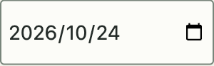
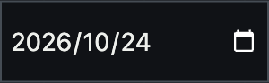
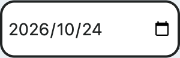
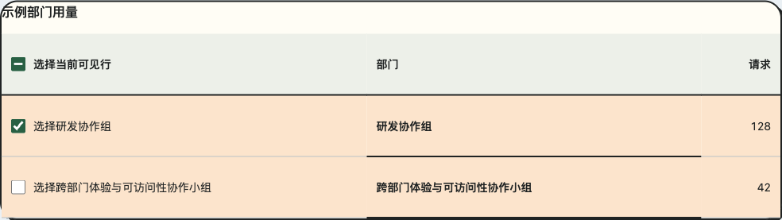
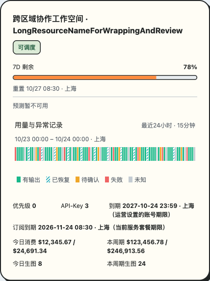

# 紧凑布局回归：#23 / #24 / #25

2026-10-25，在 `npm run check` 生成的固定生产预览中验证。内容均为合成数据，包版本未变更，修复尚未发布 npm；本次没有重跑 Gateway 消费端或生产链路。

## 检查范围

| 项目 | 范围与交互 |
| --- | --- |
| 自动检查 | 31 个测试文件、246 项测试；TypeScript；Vite 构建及 CSS/SVG 产物检查 |
| 筛选 Drawer | 三主题 × 400/520/880px × 100%/200% CSS zoom，共 18 组；原生日期末段增减、清空、非法片段、整体重置、Escape 归焦 |
| 精确日期容器 | 三主题 × 实际 150/200/280 CSS px，共 9 组；200% CSS zoom；范围与 Inline 内独立 DateField 分别编辑、清空、重置；断言实际容器宽度 |
| 无外围内距表格 | 三主题 × 三视口 × 两种 CSS zoom，共 18 组；外围 padding 为 0、单元格内距保留、鼠标勾选和 Space 取消、局部滚动至末列 |
| 紧凑账号 | 三主题 × 三视口 × 两种内容 CSS zoom × 正常/零值/未知/长值，共 72 组；事实列对齐、局部溢出、12px 尾距、44px 命中区，以及键盘/鼠标详情和图例 |
| 原生日期既有契约 | 8 项真实键盘回归：未完成片段不覆盖已接受范围、修复年份、空值片段、清空、同值预设及三个筛选示例的整体重置 |
| 最终重置焦点复核 | 三主题 × 三种实际容器宽度，共 9 项；清除独立日期后输入非法片段，重置恢复日期、移除错误并保留按钮焦点 |

`DateField` 的宿主拒绝合法提议、禁用/只读与外部值同步继续由 `tests/DateNativeInput.test.tsx` 覆盖。本次尺寸修复不改变日期字符串、时区或查询归属。

精确宽度示例使用 1280px 外层视口容纳展台侧栏；400/520/880px 窄屏另由真实 Drawer 矩阵覆盖。在 880px 外层、200% CSS zoom 下，标称 200/280px 的示例都会被 `max-width:100%` 夹到 192px，因此不能把选项值当成实际宽度证据。

## 截图

以下为 150 CSS px 容器内独立日期的三主题截图。完整年月日、日历入口与正常字号共同核对；实际末段编辑由浏览器脚本验证，截图或 `scrollWidth` 单独均不足以验收。





表格及长值账号的真实组件展台：




## 重跑

```sh
npm run check
npx vite preview --host 127.0.0.1 --port 18525 --strictPort
```

另一终端使用已安装的 `playwright-cli`，打开同一预览后执行：

```sh
mkdir -p output/playwright/issues-23-25
playwright-cli -s=rhine-layout open 'http://127.0.0.1:18525/#list-filter-bar' --headed
playwright-cli -s=rhine-layout run-code --filename scripts/check-compact-layouts.js
playwright-cli -s=rhine-layout run-code --filename scripts/check-filter-native-date.js
playwright-cli -s=rhine-layout close
```

确认返回结果分别为 `pass: true` 和 `complete: true`，再逐一检查日期截图。脚本以当前页 origin 为预览地址，不依赖固定端口。

证据限于本次 Chromium 与 CSS zoom；不等同于浏览器菜单缩放、其他浏览器或任意更小容器验收。构建通过，仍有现有的超过 500kB chunk 提示。
