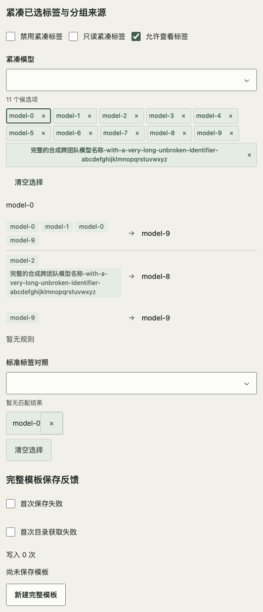
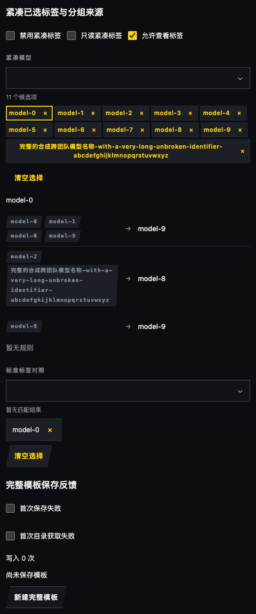
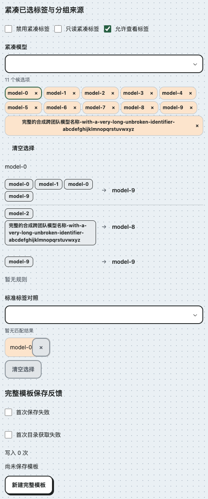
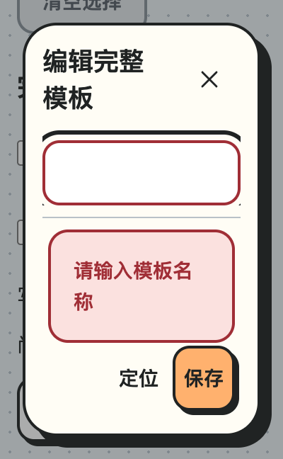

# 紧凑标签与完整模板保存（#89 增量，未发布）

本页追加 #89 的标签与反馈能力，保留此前紧凑映射、分组预览及消费验收。npm 0.11.3 和旧维护候选不包含本页新增 API；源码合并不表示消费升级。消费方需另外确认固定制品、接入与删除局部 CSS。

## 已选标签

`RemoteMultiSelect.tagDensity?: 'default' | 'compact'` 默认 `default`，与限制数量的 `maxVisibleTags` 独立。compact 使用既有 caption 字号/行高、4px 间距/内距，完整名称可换行，不隐藏移除按钮。maxVisibleTags 仍只控制显式折叠，展开后保留有界滚动。

默认目标保持44px。只有 `(pointer:fine) and (not (any-pointer:coarse))` 才将 compact 标签内激活和移除目标降为28×28 CSS px，高于24px基线；长文可长高。触屏、混合鼠标/触屏、未知指针和不支持该查询的环境均保留44px。不按最后一次鼠标事件临时缩小，不将此例外扩展到清空/展开/候选等其他控件。

激活和移除是两个独立按钮；完整 label 和焦点环保留。Enter/Space 激活只通知宿主并关闭候选；×、空查询 Backspace 删除按既有规则归焦输入。只读允许查看但禁止修改，禁用或单项锁定禁止对应动作。详情、当前对象和移除后回退仍由宿主决定。

## 分组来源标签

`MappingEditor.groupedSourceLayout?: 'branches' | 'tags'` 默认 `branches`，只在 `readOnly readOnlyLayout="grouped"` 时生效。tags 用现有 Badge 和 caption tokens 呈现来源，来源在各组左列流式换行，单一装饰箭头连接右侧一次出现的目标。容器不足360 CSS px整体纵排，长名称继续换行。列表保持首次目标顺序、组内来源顺序、重复和同值规则；不更改输入数据、不合并写入。

标签没有按钮、删除或选中语义。来源保持具名列表，目标保持可访问前缀，箭头对辅助技术隐藏。错误继续属于来源行。编辑行、空态和原 branches 默认不变。

## 完整模板与可见反馈

`#template-settings` 中“完整模板保存反馈”及 `?fixture=compact-template` 用现有 Dialog、Tabs、RemoteMultiSelect、MappingEditor、TextField、Notice、Toast 和布局组件组合。两个页签编辑同一宿主草稿，一次保存完整快照，无新增业务框架。目录获取只更新独立候选状态，不自动选中、不产生 dirty、不清除保存反馈；失败保留候选、选择与草稿并允许重试，busy同步防重且卸载清理计时器。示例用合成目录、保留名“常用模板”和350ms计时器；真实权限、请求、命名规则、空配置语义属于产品。

- 从初始空表单提交：空白/纯空格、重名、缺少来源/目标产生字段错误和固定 footer 可见摘要。名称错误聚焦名称；其他页签错误切换到对应页签并聚焦首个错误字段。摘要的“定位错误”可再次定位，不改变 URL。只在提交或明确定位时移焦，不在每次输入时抢焦点。
- footer 使用 Fragment，仅反馈包装独占整行，动作按钮保持 Dialog 的直接子元素，保留窄屏动作布局；不要用 Stack/Inline 再包住整组按钮。长正文滚动不会带走摘要、失败通知或保存动作。窄窗/200% CSS zoom 不以“DOM里有文字”替代实际可见与可达检查。
- 已保存且无修改仍可点击保存，显示“无需保存”，不再次写入。busy 时同步防重，示例拒绝关闭且卸载清理计时器。
- 失败用持续 Notice、保留草稿与已保存快照，允许重试；真正成功后才更新快照与写入次数并显示 Toast。Toast 默认5秒、可关闭、hover/focus暂停，放在固定 footer 中保持模态内可访问。再次编辑立即清除旧成功信息。
- 独立“获取目录”用 secondary 描边；标题附属轻量模板切换可 quiet。`labelAction` 是位置插槽，不推导所有动作的 variant。

测试：`tests/CompactTemplate.test.tsx`、`tests/MappingEditor.test.tsx` 和 `scripts/check-compact-template.js`。真实浏览器证明 CSS zoom、DOM/键盘和合成宿主流程；原生网页缩放、读屏语音与真实服务另验。

2026-10-29 评论 6497842246 取代此前“整组 Stack/Inline footer”建议。普通有界 Dialog 同样建立实际容器查询，让原有 ≤300px 直接动作规则生效；显式固定高度的单栏有界表单 footer 后备上限为60%（保留 `--rhine-dialog-footer-limit` 优先级，自动高度的测量上限不变），容纳一条反馈与动作，设置导航/分栏仍保留原预算。648px短屏另测正文至少44 CSS px可操作空间；不新增插槽或消费 CSS。

## 验收边界与反例

`check-template-footer.js` 以三主题、400/520/880、100/200% CSS zoom、648px高窗口，从空白、重名到失败、成功和无改动，检查整个44px动作、提示行、正文至少一个控件的空间，以及 footer 无内部裁剪。`?probe=footer` 临时恢复40%上限作为反例；`check-compact-template.js` 的 `?probe=clip` 定向裁剪长标签。反例只修改测试页面。

普通有界 Dialog 新建容器后，后代现有 footer 的≤559px间距和≤300px按钮规则以实际 Dialog 宽度计算；MappingEditor/ListFilterBar等有自身容器，仍以自身容器计算。settings 已有容器保持不变，split 的媒体查询分栏保持不变。普通单栏有界表单在≤700px高窗口沿用现有窄窗12px内距，避免880px×200% CSS zoom的短窗口仍消耗标准24px外框内距。对应回归入口为 `check-settings-bounded.js`、`check-dialog-scroll-boundaries.js`、`check-compact-selection.js`；自动高度继续优先使用测量变量，不被60%后备值覆盖。

保留失败：首次单测误用了查询 API，随后类型检查检出未使用导入和错误参数；首次浏览器自动检查虽通过，截图发现 footer 动作裁剪，原因是检查先滚动且只量文字。补充整个按钮/不滚动断言后，400px×200%下橙趣主题及648px短屏复现。整组Stack被Fragment取代；普通有界Dialog缺少容器与反馈预算的缺口一并修正。修复期间中止的一次浏览器运行记录为中止，不计通过。安装制品初次矩阵还将 viewport-fixed Dialog 错算入 body 的 overflow 裁剪；检查器现按固定定位包含块处理，并保留无透明/隐藏祖先检查与原长标签裁剪反例。后续结果须绑定精确提交与制品，CLI退出码不代替JSON。

截图使用合成值：

## #89 短屏设置反馈修正（取代原设置 footer 一律 40% 的边界）

真实设置导航、长对象标题及完整保存反馈与单栏表单预算不同。视口高度不超过700px时，有界设置对话框外框上下各保留4px，内距8px；实际内容容器不超过559 CSS px时，反馈 Notice/Toast 使用4px纵向、8px横向内距，正文/导航/底部间距4px，footer后备上限50%。按钮完整命中区不缩小，主题边框和关闭按钮保留。显式 `--rhine-dialog-footer-limit` 优先，自动高度的测量值仍优先；普通单栏、分栏和700px以上窗口保持既有规则。

`?fixture=compact-template&settings=1` 使用设置导航、对象标题和完整失败/无改动文案；加 `auto=1` 检查自动高度。三主题、400/520/880、100/200% CSS zoom、648px短屏检查整个按钮、反馈文字与正文至少44 CSS px；超长错误继续通过独立footer滚动访问，不能据有限合成文案声称无限长度始终同屏。无业务CSS或新通知组件。
