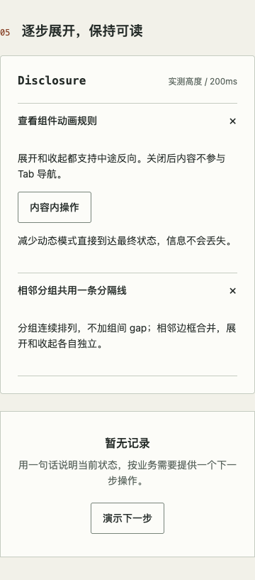
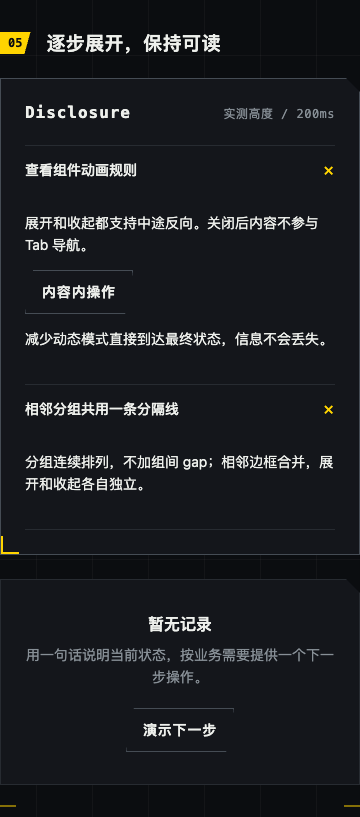
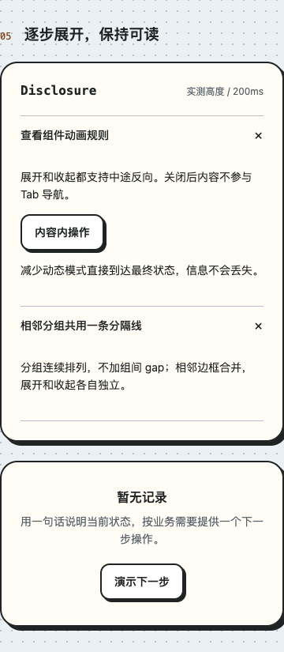

# Disclosure 连续分组验收

对应 [issue #37](https://github.com/linhay/rhine-design/issues/37) 与 [PR #38](https://github.com/linhay/rhine-design/pull/38)。相邻边框、零 gap 契约和双组展台已在 `e7461af` 实现；本轮补齐验收，并修复生产 CSS 时间单位归一化导致的动画过快。两项均为 npm 0.10.0 之后的未发布源码变更。

## 源码与环境

- 日期：2026-10-27，Asia/Shanghai。
- 行为源码：`e86aeea412b33f739e2e01531ae82c96ed5fbe4c`；本记录及截图的后续提交不改变组件、样式、展台或测试。
- Node 24.21.0、npm 11.19.0、macOS 27.0.1、Chrome 155.0.8059.85。
- 使用 `npm run build` 的生产展台，通过本机 Vite preview 访问 `#disclosure`，内容均为内置合成示例。
- JavaScript `index-BS5CgdA1.js` SHA-256：`b67e184dd6a8eb06ea95e35fc17165bbcbfd786613a3ad6f5b510f70547d6c66`。
- CSS `index-ZqNLTCyY.css` SHA-256：`869b49dd6c91c604169311a85bf635e34732406a3386c48eddcc2d31754ec473`。

## 结果

| 场景 | 结果与证据 |
| --- | --- |
| 全量检查 | PASS：Node 24 下 `VITEST_MAX_WORKERS=1 npm run check`；34 文件、265 测试，类型与生产 CSS/SVG 制品检查通过。未修改测试超时或断言。 |
| 三主题 × 400/520/880 CSS px × 四种开合 | PASS：36 组均保持 gap 0、前组上下边界 1px/1px、后组上下边界 0/1px；开合独立。 |
| 单组件边界 | PASS：每个主题/宽度临时移除第二组，第一组上下边界仍为 1px/1px，共 9 组。随后完整重载展台。 |
| 换行与可读性 | PASS：三主题窄窗标题与正文换行、正文无水平溢出、页面无横向滚动；见下方截图。 |
| 原生网页缩放 200% | PASS：隔离 Chrome 的 `chrome://settings/appearance` → 网页缩放选择 200%；CSS zoom 为 1，visualViewport.scale 为 1。预缩放视口 800/1040/1760 对应 innerWidth 400/520/880，再跑上述 45 组布局检查全部通过。 |
| Enter / Space 与 Tab | PASS：三主题 Enter 展开、Tab 进入内部按钮、Shift+Tab 回标题、Space 关闭、Tab 跳到第二组标题；关闭内容退出键盘顺序。100% 与原生 200% 均覆盖。 |
| 真实动画与快速反向 | PASS：生产计算样式 `.2s`，Web Animation duration 实测 200ms。70ms 中途存在活动动画及中间高度；反向从当前高度开始、旧动画取消，再次反向后最终展开且无残留动画。100% 与原生 200% 均覆盖三主题。 |
| 系统与手动减少动态 | PASS：系统偏好通过真实 Chrome 的 media emulation 触发；手动使用展台“减少动态”。两者均立即到达开合结果；系统偏好切换中断在途关闭，手动切换中断在途展开。100% 与原生 200% 均覆盖三主题。 |
| CSS zoom 200% | N/A：本轮 200% 使用浏览器原生网页缩放，不以 CSS zoom 替代。 |
| 其他浏览器、系统设置面板、消费方 | SKIPPED：未覆盖 Safari/Firefox、真实 OS 偏好面板或消费应用；系统媒体偏好由 Chrome 模拟。 |
| npm 发布 / iOS | N/A：不在本轮范围。 |

交互矩阵每个缩放级别为三主题 × 九项，共 27 项；两种缩放合计 90 项布局与 54 项交互结果。截图仅证明外观，动画结论来自运行时量测。

## 保留的失败与验证限制

- 修复前生产 `.2s` 被直接 `parseFloat`，实际 duration 为 0.2ms；三主题快速反向检查均 FAIL。新增单测覆盖 `200ms`、`.2s`、`0ms`、`0s`。
- 首次候选全量检查为 29 个 5 秒超时及一个 worker 启动超时；限制两 worker 后仍有 7 项失败（含超时及等待状态断言）。最终单 worker 完整检查通过。同期存在主机并行负载，但未确认这些失败的根因，不能视为产品修复证据。
- 首次新增动画桩类型不完整，类型检查与对应 CI FAIL；补齐测试桩类型后通过。失败修订保留在 PR 历史。
- 首次布局脚本临时移除第二组后未重载同 URL，导致定位第二组超时；已改为每组完整 reload。旋转图标的包围盒产生约 6px scrollWidth 差值，逐项核对后确认正文没有溢出，不能把装饰变换直接当作正文裁切。
- 原生应用控制接口曾无响应；最终缩放矩阵改用隔离 Chrome 内置设置完成。元素截图在原生缩放下裁剪不准确，原生缩放外观使用整页视口截图复核。
- 本地原始结果位于忽略目录 `output/playwright/issue-37/`；公开内容仅保留脱敏摘要与组件截图。

## 组件截图（100%，400 CSS px）

| 莱茵 | 战术终端 | 橙趣 |
| --- | --- | --- |
|  |  |  |

[原生 200% 网页缩放视口截图（莱茵主题）](assets/disclosure/rhine-native200.png)。

重验时先构建最终源码，再在 `#disclosure` 依次检查全收起、前开后关、前关后开、全展开；量测 `getBoundingClientRect()` 间距与计算边框，并执行上表键盘和动态偏好步骤。生产动画须检查 `Animation.effect.getTiming().duration`，只看源码 token 或最终截图不足以判定正确。
