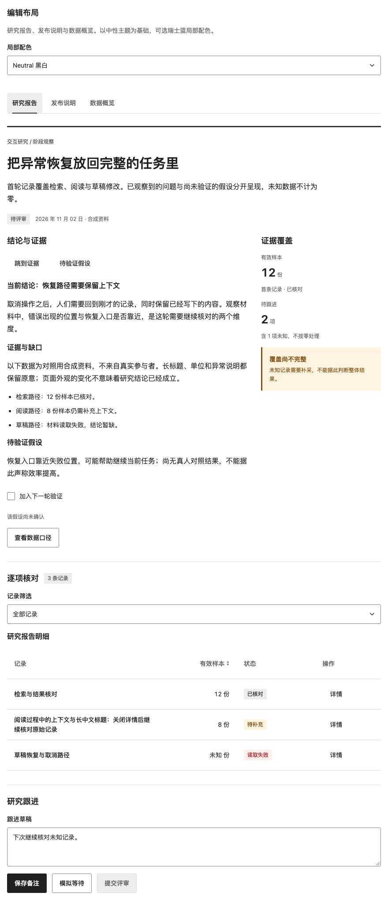
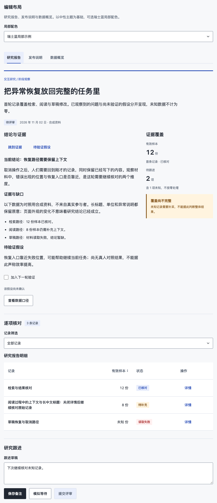

# 编辑布局配方（源码组合，未发布）

面向研究报告、发布说明与数据概览：先组织结论、证据、版本/兼容边界与数值/未知状态，再选择排版与局部配色。复用现有 Text、Surface、Tabs、DataTable、TrendChart、Dialog 等公开组件，不新增布局组件、ThemeName 或颜色角色 API。npm 0.11.3 不包含此展台；固定并核验源码候选后才能复用。

真实入口为 `#editorial-layout`，目录「设计语言 → 编辑布局」可达；独立验收 `?fixture=editorial-layout`。默认以 neutral 为基础，瑞士蓝为该主题根的局部示例。进入该章节不会重写原来的全局主题偏好，离开后恢复；章节内的配色/场景切换不重挂载草稿或详情。样例全部是合成数据与确定性的本地操作，保存/重试不请求服务。

## 结构与状态

| 场景 | 必须可见的事实 | 可完成的动作与退出 |
| --- | --- | --- |
| 研究报告 | 当前结论、证据覆盖、读取失败与待验证假设分开 | 定位章节、选择/取消下一轮验证、筛选排序、读取详情 |
| 发布说明 | 版本、分组变更、兼容/未发布边界、未知制品体积 | 定位兼容说明、展开迁移核对项、补充本地备注 |
| 数据概览 | 数值与单位、覆盖比例、趋势缺口和原始采样 | 键盘读取趋势/未知时段、打开原始表、跟进异常 |

详情取消或 Escape 放弃本次编辑，显式保存才写本地备注；关闭回到原行触发器。已保存备注由场景按记录id持有，筛选移除再恢复、排序和切换场景都不丢失；不同场景的相同id不共享备注。主页面失败保留草稿，重试后显示确定的本地结果，等待可取消。禁用评审动作不伪装成可提交。筛选、排序、草稿由场景宿主管理；未知始终排序在末尾，不补零。

## 排版与容器

- 标题仍使用界面字体和正常字重。正文局部16px/28px、最大38em；摘要最大44em。这是本配方的上限与示例数值，不是窄屏最低行长，也不是所有组件的全局字号。
- 正文与辅助事实列在宽容器采用2:1分列，摘要仍位于顶部；内容容器达到640px才分栏。窄容器单栏，表格保留带名称的键盘横滚区，完整长标题和未知说明可在详情读取。
- 内部阅读区用无内距、低边框的宿主组合，避免卡片层层嵌套。组件命中范围与字号不压缩。control 3px/card 4px是本配方局部几何，neutral默认仍为10/16px。
- `container-type:inline-size`放在内容包装层；主题根不添加transform、contain或裁剪，以免影响Portal。CSS zoom与实际容器都需要验收，不能仅依赖视口媒体查询。
- 正式展台已处于GalleryShell的main内，因此场景用section；页内定位直接聚焦/滚动到自身标题，不占用展台hash路由。非活动Tabs面板不可见且不参与顺序聚焦。

最小宿主骨架（类名是应用自己的配方，不是新增组件API；宿主CSS在neutral主题CSS之后加载）：

```tsx
<ThemeProvider theme="neutral" className="rhine-editorial-example">
  <div className="rhine-editorial-content">
    <Text as="h1" variant="title">研究报告</Text>
    <div className="rhine-editorial-columns">
      <section><Text>结论、证据与待验证假设。</Text></section>
      <aside><Text>单位、覆盖与未知状态。</Text></aside>
    </div>
  </div>
</ThemeProvider>
```

```css
.rhine-theme.rhine-editorial-example { --rhine-radius-control:3px; --rhine-radius-card:4px; }
.rhine-editorial-content { container-type:inline-size; min-width:0; }
.rhine-editorial-columns { display:grid; grid-template-columns:minmax(0,1fr); gap:24px; }
.rhine-editorial-columns > * { min-width:0; }
@container(min-width:640px) {
  .rhine-editorial-columns { grid-template-columns:minmax(0,2fr) minmax(180px,1fr); gap:32px; }
}
```

## 瑞士蓝局部配色与Portal

配色与排版独立。neutral也可使用上述排版；蓝色不证明任务速度更快或用户更喜欢。候选用冷白画布、墨色、小范围蓝色重点；主按钮仍是墨色。公开颜色变量的完整示例在 `preview/editorial-layout.css`，只命中带 `data-rhine-editorial` 的主题根，不注册第六个主题或修改默认值。

| 变量 | 局部示例 |
| --- | --- |
| bg / content-bg | #f7f8fa |
| surface | #ffffff |
| sidebar-bg | #eef1f7 |
| ink / muted | #202631 / #566171 |
| line / control | #d5dce7 / #788393 |
| green / selected | #2348b5 / #e9eefc |

变量必须放在拥有浮层的最近 `.rhine-theme` 根；只放普通section不能传到挂在主题根的Dialog/Popover。使用独立或并列ThemeProvider，不能嵌套。示例在挂载时给已有主题根添加局部属性，切色只改变该属性，卸载恢复原属性；真实应用可直接在自己拥有的ThemeProvider上声明class/style。

历史变量green同时影响重点与success；既有独立变量`--rhine-chart-series-1`默认引用green，因此首个图表系列也随其变化。本例接受蓝色成功强调，始终保留“已核对/已保存”和未知标记、错误/警告语义。没有实现品牌色与成功色解耦；该问题继续由#157研究，书卷/appearance与#61新研究不在此配方范围。

## 验收与消费边界

先 `npm run check`，再对冻结生产输出运行 `scripts/check-editorial-layout.js`。覆盖3场景×2配色×400/520/880及CSS200%、系统/手动减少动态、颜色/必要边界、真实排序与键盘归焦、图表与非活动面板，另测正式外壳的导航/退出清理。新测量需有定向破坏检出，不能以退出码代替JSON pass。 `?probe=opacity`实际降低归焦按钮和文本域边界的透明度，应返回UNMEASURED且pass:false；`?probe=unknown-marker`把未知×的描边宽度置零，应命中chart-missing FAIL，不能只检查折线。两者都必须实际完成场景且无定位或页面错误。

复验必须在新的replay目录执行，截图和日志写入其中，不覆盖固定证据。固定候选tarball与全新安装的示例/公开入口另验；不由研究阶段旧96矩阵外推本次源码。CSS zoom不等于原生网页缩放，selectOption不等于原生下拉菜单键盘，DOM/AX不等于读屏语音。实际结果与未覆盖项见对应PR。源码合入不表示npm发布或消费项目升级。

同一报告在880px独立容器中的示例（CSS zoom 1；静态截图仅用于核对布局，交互以真实展台为准）：

| Neutral 默认 | 瑞士蓝局部配色 |
| --- | --- |
|  |  |
