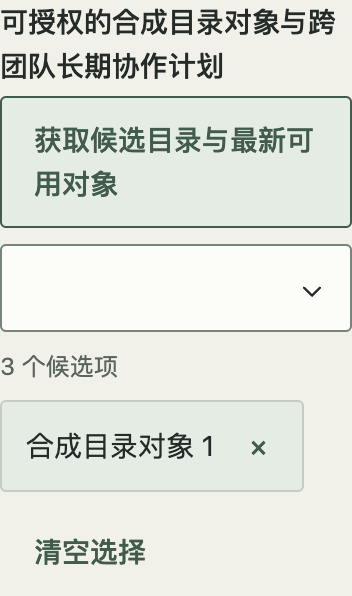
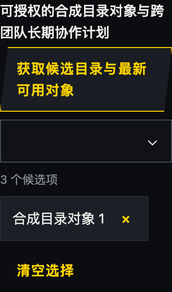
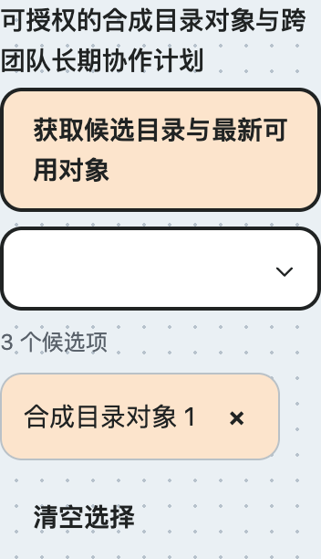

# 字段标题附属动作（#78，未发布）

`Combobox` 和 `RemoteMultiSelect` 提供可选 `labelAction?: ReactNode`。`label` 仍为 string：输入框、候选列表和多选已选列表的名称保持原样，不拼接按钮文案。不传动作时保留原 label DOM 和布局。该能力是源码候选，npm 0.11.3 不包含。

```tsx
<RemoteMultiSelect
  label="授权对象"
  labelAction={<Button variant="quiet" busy={fetching} busyLabel="正在获取目录"
    disabled={!canFetch || disabled || readOnly} onClick={fetchDirectory}>获取候选目录</Button>}
  query={query} onQueryChange={setQuery} options={options}
  value={selected} onValueChange={setSelected} disabled={disabled} readOnly={readOnly}
/>
```

动作与 label 是标题行中的兄弟节点，不把交互元素嵌入 label。使用已有 quiet Button（默认 `type="button"`），保留至少 44px 命中、focus-visible、长文换行；空间不足时动作换行并靠逻辑末端。不要给插槽添加另一套字段标题或把它当作清空、完成、保存入口。插槽接收 ReactNode 以支持宿主组合；组件不克隆它、不注入可用状态、不推断权限。

## 状态和焦点所有权

- 宿主明确给动作设置 `busy`、`disabled` 和权限。字段的 `loading`/`disabled`/`readOnly` 只控制选择，不自动禁用任意插槽内容。例如只读字段仍可放“查看说明”；会更新目录的动作应由宿主在只读、禁用或无权限时禁用。busy Button 保持焦点但阻止重复点击，宿主同步防重入。
- 标题动作在输入框之前的正常 Tab 顺序中。输入框 Shift+Tab 返回动作并收起候选，动作 Tab 可回输入框。候选分页/完成的顺序继续沿原契约；Shift+Tab 从分页/完成回输入框，再到标题动作。
- 动作收到焦点或 click 时收起候选，不把焦点送回输入框、不选择、不触发表单提交；原 label 点击仍聚焦输入框。宿主主动打开 Dialog 或移交焦点时，已有延迟关闭逻辑尊重该落点。无动作时不增加 Tab 停靠点。
- clear/remove/完成与已选项激活继续使用现有契约。目录按钮不借用这些回调，也不自动提交或选中全部候选。

## 获取目录的宿主组合

网络、来源权限、查询、游标、取消与错误均归宿主。成功只替换/追加候选；已选对象保存完整 label，不能依赖当前候选存在。失败保留原候选、选择和草稿；空目录可以呈现空候选，但保留选择和草稿。重新获取不是清空或保存。

开始请求时同步防重入；取消、换来源、禁用/只读和卸载使请求代次失效，并中止传输。传输忽略 abort 时也按代次丢弃迟到结果；卸载清理计时器/订阅。取消后可以重试，新结果不得被旧请求覆盖。不要把延迟响应写回重新挂载的编辑草稿。

## 真实展台与验收入口

`#compact-filters` 的“字段标题附属动作”使用公开组件；直接夹具 `?fixture=label-action` 支持 `theme`、`zoom`（CSS zoom）及 `motion`。合成宿主提供成功、失败一次/重试、空目录、忽略取消的慢响应、取消/卸载、禁用/只读、分页、嵌套 Dialog 和显式提交。业务接口与原消费升级不在此示例中。

`tests/LabelAction.test.tsx` 验证语义/所有权和异步清理；`scripts/check-label-action.js` 对生产构建运行三主题、400/520/880、100/200% CSS zoom、长文/44px、正反向 Tab、点击、异步和三动态偏好。既有 remote-selection / multiselect-completion 脚本单独回归，不以新示例替代。固定制品须全新安装且核对源码逐字一致，后置公共 CSS 再跑相同夹具。原生网页缩放、读屏语音、其他引擎和真实后端另行验收。

## 源码验收记录 · 2026-10-29

- PASS：Node 24.21.0；409 项测试、类型、生产构建、两个评审构建及包检查。Chromium 156.0.8078.48 的 18 组标题布局/键盘（3 主题 × 400/520/880 × 100/200% CSS zoom）、9 组三动态偏好的异步流程通过；减少动态分别核对 spinner 的计算 animationName 与真实结果。
- PASS：既有远程选择 18 组、多选完成 18 组和首次失败/正常/慢响应/忽略取消 4 种回归。包括 clear/remove、分页、完成、嵌套 Escape、快速重开与延迟归焦。标题动作不提交表单，显式 submit 单独验证。
- PASS：浏览器临时注入 60px 固定宽度、nowrap 和 hidden 裁剪反例，18 组均正确报告 action text clipping；原始正常与反例结果分别保留，不修改正式组件来制造反例。
- 保留 FAIL：首轮测试把两个 status 当作唯一节点；浏览器 runner 无全局 URL；busy 后按钮名称变化导致定位等待到完成；嵌套 Dialog 在关闭动画完成前尚未归焦。这些检查修正为具名结果、浏览器内 origin、稳定按钮节点及有界实际归焦等待，后续完整矩阵通过，不宣称修复了组件中不存在的根因。
- SKIPPED：原生网页缩放、读屏语音、完整其他引擎、真实后端与原消费升级。N/A：新增动画循环（仅复用 Button 的既有 busy spinner）。未发布 npm。

窄屏截图是 400px 视口、200% CSS zoom 的局部字段，长标签/动作完整换行，截图不替代交互证据：




