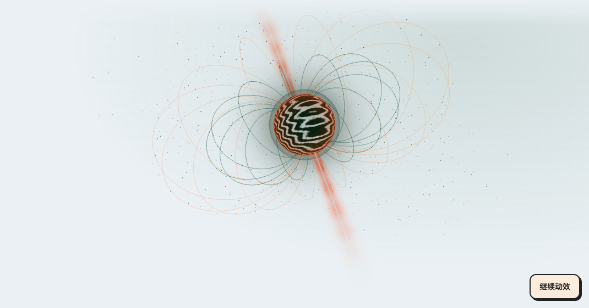
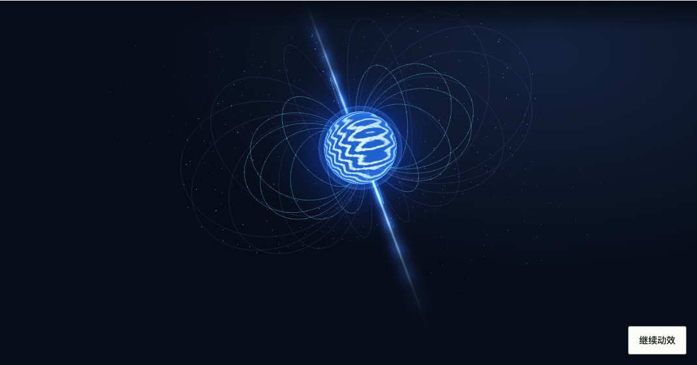

# NeutronStarBackdrop · 中子星背景

`NeutronStarBackdrop` 将授权移交的中子星背景维护为通用艺术组件。它保留 28 条磁场线、560 个沿磁场流动的粒子、700 颗星尘、极向喷流与星核；星系以 28 秒有效播放时间完成一轮深度公转。镜头固定，星系整体沿三维方向移动，由透视产生远近与尺寸变化。原始构图与运动关系由库维护；主题仅改变艺术配色。移交需求见 [Issue #12](https://github.com/linhay/rhine-design/issues/12)。

**版本边界：**本组件为未发布的源码候选，npm `@linhey/rhine-design@0.6.0` 及以前不包含它。接入前核对实际 `components/index.ts` 与安装版本；候选消费固定精确 commit，发布后再切换精确版本并提交 lockfile。组件与 Three.js 渲染实现随包分发，渲染模块按需加载，不要求宿主复制算法或自行加载 CDN 脚本。固定依赖 `three@0.186.1` 与 `@types/three@0.186.0`；后者随依赖分发，以便消费本包 TypeScript 源码的工程解析类型，不进入浏览器运行代码。

## 使用与职责

```tsx
import { NeutronStarBackdrop, Stack, Surface, Text } from '@linhey/rhine-design';

// 要求包含此 API 的精确源码候选；放在已有的主题根内。
export function Observatory() {
  return (
    <NeutronStarBackdrop style={{ minHeight: 480 }}>
      <Stack style={{ padding: 'var(--rhine-space-6)' }}>
        <Surface>
          <Stack gap={2}>
            <Text as="h1" variant="title">探索新的可能</Text>
            <Text>内容与操作始终可用，不等待艺术初始化。</Text>
          </Stack>
        </Surface>
      </Stack>
    </NeutronStarBackdrop>
  );
}
```

| 输入 | 契约 |
| --- | --- |
| `HTMLAttributes<HTMLDivElement>` | 原生容器属性；宿主负责页面位置、`height` / `minHeight`、内容分组和相邻布局 |
| `appearance?: 'theme' \| 'original'` | 默认 `theme`，读取当前主题语义色；`original` 保留原始深空配色，只影响艺术层与直接叠加内容的可读前景，不建立新的主题根 |
| `reducedMotion?: boolean` | `true` 加强减少动态；`false` 或省略不能覆盖系统、祖先或环境的停帧条件 |
| `children` | 可选普通 HTML / React 内容，置于 `.rhine-neutron-content`；表单、请求与业务状态仍归宿主 |

公开入口是 `NeutronStarBackdrop` 与 `NeutronStarBackdropProps`，内部绘制模块不是公共 API。无速度、粒子数量、进度或业务参数；需要改变艺术配方时先补库内契约与展台。根容器是 `.rhine-neutron`，装饰层 `.rhine-neutron-art` 为 `aria-hidden`，渲染成功后有 `.rhine-neutron-canvas`。这些类名用于识别与调试，不授权宿主覆盖渲染、暂停或降级状态。

内容层仅在底部预留暂停控件安全区：`44px + 2 × --rhine-space-4`，当前为 76px；不强制正文四边内距。宿主决定内容边距，可像上例在自己的 Stack 上使用 24px 的 `--rhine-space-6`，或直接沿用已有页面边距，避免叠加两层内距。保留底部安全区，不覆盖内部 `.rhine-neutron-content` 样式来重排按钮。

内容与控制区域占用各自布局空间，暂停按钮不悬盖正文。宿主可用 Stack、Inline、Surface 组合内容，不给整棵内容树加透明度或模糊滤镜。主题切换、艺术加载失败与暂停均不隐藏文字、禁用业务操作或清空输入。画面只是装饰，不是 `Progress`、`Skeleton`、连接状态或科学数据可视化。

## 播放、暂停与减少动态

组件自带“暂停 / 继续”按钮。使用随动作改变的名称，不同时附加 `aria-pressed` 切换语义；键盘焦点与按钮状态使用宿主主题。点击继续仅取消主动暂停，不越过以下限制：

- 系统 `prefers-reduced-motion: reduce`；
- `reducedMotion` 为 `true`；
- 任一祖先的 `data-rhine-motion="reduced"`，内层 `system` 不能覆盖它；
- 页面隐藏、组件离屏或可用绘制尺寸为零。

任一停帧条件成立时停止请求新帧，而不是只用 CSS 隐藏 Canvas。恢复时从冻结的动画时间继续，不补算隐藏期间的时间，不追赶错过的帧。单帧有效时间增量上限为 0.05 秒；后台停帧或前台卡顿后不追赶墙钟时间，因此 28 秒指有效播放时间。尺寸变化以当前时间重新绘制；主题或 `appearance` 改变只更新颜色，不重新启动公转。宿主无需为主题切换更换 key。

此组件不按窄屏宽度自动关闭；窄屏仍遵循相同的系统、显式及环境偏好。尺寸与像素比由内部渲染器处理，宿主不得以 CSS 缩放后的测量值重复放大绘制尺寸。检查实际画布是否持续播放或冻结，不能把截图相同或 `animation: none` 当作停帧证据。

艺术层与正文高度分开：艺术区域最多 740px，视口不超过 600px 时最多 620px，并在上下渐隐；正文和控制区仍使用完整页面空间。窄而高的区域使用适配取景，相机横向对准公转中心并保留足够的水平视野，确保整个星核在完整周期中可见。标准宽幅继续原始取景，磁场几何、粒子、旋转和公转公式不变。宿主不得通过覆盖内部画布尺寸修补长页，须用真实页面高度和多个公转相位验收。

## 加载与资源释放

服务端渲染不访问 `window`、`document` 或 WebGL；挂载后再异步加载绘制模块。SSR 可安全输出组件静态结构，不等于完整应用的 SSR 构建已经验收。装饰初始化不阻塞 `children`。组件在异步加载完成前卸载时，迟到结果不创建脱离页面的渲染器。

没有 WebGL、模块加载失败或 WebGL 上下文丢失时显示静态艺术与原有内容；上下文恢复后重新建立可用绘制并遵循当前停帧条件。静态降级不表示业务失败，也不无限显示“加载中”。卸载取消逐帧任务，移除监听器与 observers，释放已创建的几何、材质与渲染器等 GPU 资源。

静态 fallback 使用当前艺术配色保留星核与磁场的视觉意图，不保证复现 WebGL 的三维透视、粒子数量或某一时刻的精确画面。减少动态但 WebGL 可用时保留实际冻结帧；能力不可用时才以这幅静态替代图承接。

根的 `data-rhine-neutron-state` 可观察当前装饰状态：`loading`、`playing`、`paused`、`reduced`、`hidden`、`offscreen`、`empty` 或 `unavailable`。这些不是业务状态；`empty` 表示绘制区域无有效尺寸，不能据此把业务内容当作空数据。宿主不要用它控制请求或完成状态。

## 主题与内容组合

默认 `appearance="theme"` 从 Rhine、Arknights、Neo Brutalism 的现有语义 tokens 取得配色，不新增一套产品色值或公共主题 tokens。切换主题时保持磁场构图与动画时间；默认展台先展示完整艺术，便于核对三主题的表达。

`appearance="original"` 保留原始深空艺术，直接叠加的文字使用可读前景；Surface、Button、表单等实体控件仍使用宿主主题的前景与背景组合。不覆写整个子树的主题 tokens，不创建嵌套 ThemeProvider。优先把需要持续阅读的长文或表单组合到 Surface，背景不能模糊或遮住正文与操作。

重播是展台或宿主主动发起的装饰动作，不能执行业务请求。需要重建艺术时仅改变装饰边界的 key；表单草稿应由边界外宿主持有，或放在不参与重播的独立组合实例中。不要给包含整页表单的页面根更换 key。

## 真实展台与验收

本地 `http://127.0.0.1:18309/#neutron-star` 复用公开组件；在线展台跟随 main，未合并前不保证此章节可访问。主视图只放艺术，默认收起“演示控制”和“查看内容组合”。展开后可选择跟随主题 / 原始深空、手动减少动态和重播，并检查 Surface、输入及按钮组合。重播主艺术不会重建下方组合或清空观测名称。

以下是验收要求，不是已执行的验证结论：

1. 在不同时间采样完整中子星画面，确认磁场线、流粒、星尘、喷流与星核可辨，星系以 28 秒有效播放时间完成一轮深度公转，保留原视觉意图。
2. 鼠标和键盘暂停 / 继续；暂停后实际帧循环停止，继续不跳过冻结时间。
3. 分别验证系统、prop、祖先减少动态及恢复；内层 `system`、`reducedMotion={false}` 和继续按钮均不能覆盖更强偏好。
4. 三主题与两种 appearance，400 / 520 / 880 宽度及 200% 缩放；内容、提示、按钮默认 / hover / disabled / 焦点清晰，无横向溢出或控制入口遮挡。
5. 主题改变与 resize 保留当前时间；页面隐藏、离屏、零尺寸停帧后可恢复，未发生时间追赶。
6. 初始化前卸载、正常卸载、Strict Mode 重建与异步迟到结果不遗留 rAF、监听或 GPU 资源。
7. 模块失败、无 WebGL、context lost 均保留静态艺术与可用内容；context restored 后按当前偏好恢复。
8. 展台重播保留用户输入与外部按钮焦点；隐藏在 Disclosure 内的实例不能持续后台绘制。

单元测试不代替 WebGL 真实浏览器画面；库展台也不代替消费页面、原生 WebView 或完整辅助技术验收。接回宿主后仍须检查实际入口和业务操作。

### 本候选的验证记录

2026-10-24：`npm run check` 通过 153 项测试、TypeScript 检查、Vite 生产构建及 CSS/SVG 制品检查。新增测试使用真实 Three 场景结构并替换 WebGLRenderer，检查完整场景数量与 28 秒有效播放时间、系统与显式减少动态、暂停恢复、CSS zoom / DPR 尺寸、上下文丢失恢复、异常与卸载清理；同时覆盖 SSR 静态输出、异步导入失败/迟到、Strict Mode 与展台草稿保持。这些单测不代表真实 GPU 或浏览器画面已经验收。

生产展台构建将 Three 与绘制实现保留在独立异步块：渲染块约 538 kB（gzip 134 kB），初始入口不会静态导入该块。是否挂载本组件由消费端决定，加载失败始终保留静态艺术。

本地 Chromium 真实 WebGL 展台通过 28 项动态及生命周期断言，另有 2 项原始配方下的主题控件组合检查，页面错误和非本地请求为 0。三主题 × 两种 appearance × 400 / 520 / 880 宽度 × 100% / 200% CSS zoom 共 36 组布局通过；无页面横向溢出，暂停入口保留在画幅内。CSS zoom 不等于浏览器原生页面缩放。

约 28.61 秒墙钟内观察到 28.58 秒有效播放、637 个绘制帧及 147 个不同的像素采样，3D 投影矩阵随公转变化；不是仅凭截图判断动画存在。键盘暂停 / 恢复、系统 / prop / 祖先减少动态、主题和 appearance 切换、真实离屏、零尺寸、上下文丢失及恢复、表单草稿保持均通过。卸载后无待执行 RAF 或继续绘制，相关监听器与 observers 清理；已分配的绘制 buffers / VAO 释放，program 删除并丢失 WebGL context，剩余驱动资源随 context 释放。

`document.hidden` 使用 getter 覆盖并派发 `visibilitychange` 验证停帧分支；headless 后台标签没有产生真实 hidden 状态，因此不把这项算作浏览器后台标签验收。无 WebGL 分支在浏览器中通过移除 `WebGL2RenderingContext` 入口模拟，确认没有 canvas、静态艺术可见且动效按钮禁用。GPU 初始化中途异常及异步导入失败由单元测试覆盖。

### 长页取景回归

后续真实消费页在 400px 宽、正文约 1008px 高时暴露初始取景缺陷：艺术层随正文增高，垂直视场不变导致水平视场过窄，星核在部分公转相位移出画面。此前固定 560px 展台的布局与动态通过不能证明这种长页画幅正确。现已在库内独立限制艺术高度，并对窄画幅适配相机取景，宿主无需覆盖组件内部 CSS。

新增单元回归逐一投影星核几何顶点，在 400×1008、400×620、160×620 和 880×740 四种画幅的九个公转相位验证完整星核留在画幅内。包含此回归的 `npm run check` 通过 157 项测试、类型检查、构建及制品门禁；几何、粒子和 28 秒时间公式保持不变。

真实 WebGL 追验采用 400×1008 的宿主，因测试视口为 648px，实际艺术层上限为 740px。三主题共 27 个公转相位均能完整显示核心：有效时间覆盖 0.17–28.30 秒，320px 宽像素采样中的核心横向范围为 70–247，无贴边或消失。此证据不冒充实际 400px 视口的 620px 上限消费页验收；接入页面须另查其真实 viewport 和艺术尺寸。

真实展台截帧仅展示当时画面；动态与资源验收按上述独立检查记录。




