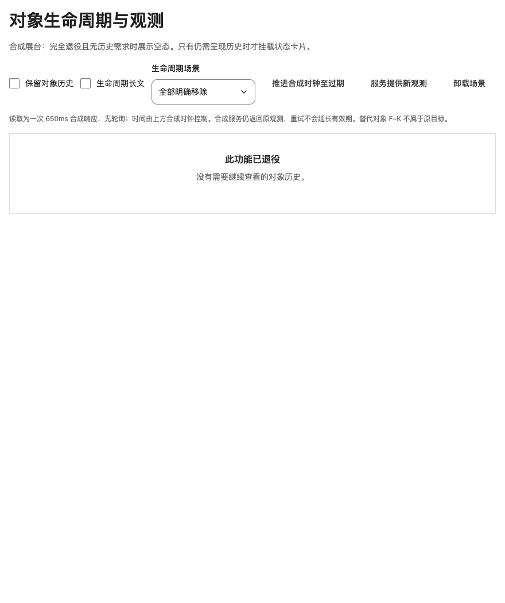
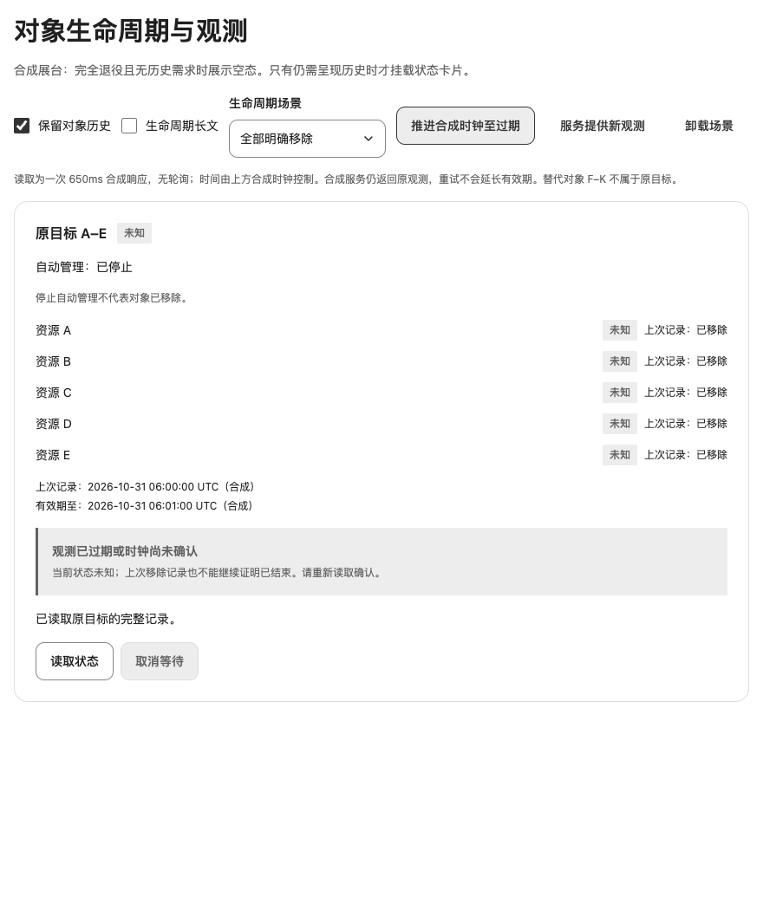

# 对象生命周期与观测有效期

对应 [#144](https://github.com/linhay/rhine-design/issues/144) 及[退役功能的范围修正](https://github.com/linhay/rhine-design/issues/144#issuecomment-6528994313)。复用公开 Badge、Surface、Text、Notice、EmptyState 等组件；真实合成展台 `/#object-lifecycle`，隔离入口 `/?fixture=object-lifecycle`。这是未发布的源码组合配方，不新增公共业务模型、Hook、调度抽象或依赖，也不表示 npm 发布或原消费产品升级。

## 先确定是否还需要历史

**宿主已确认功能全部退役，且用户没有继续查看历史状态的需求时，直接使用现有 EmptyState。** 移除旧入口的读取和轮询，不挂载历史卡片及其快照运行依赖；不要为显示“已结束”而继续维持无用观测。读取失败、空响应或暂时无权限都不能代替这一业务确认。保留既有数据兼容与是否继续运行旧界面是两个决定。

这项范围修正取代原反馈中的消费端已结束卡片方案：原消费端已撤回该卡片，改为空态；它不是等待接入本配方的消费者。下面的生命周期配方只适用于**仍需呈现原对象历史**的场景，不要求所有退役功能保留卡片。

## 三类事实分开

| 事实 | 呈现与边界 |
| --- | --- |
| 停止自动管理 | 只表示控制意图；既存对象仍展示有依据的状态。不能据此显示“已移除”或“已结束”，也不能推断仍在进行的外部操作已经排空 |
| 对象已移除 | 必须来自后端对原目标身份的明确确认。仍在有效期内且完整覆盖全部原目标时，汇总用中性“已结束”，逐项用中性“已移除”；移除不是执行成功，不使用成功绿或未知告警替代这一事实 |
| 观测未知或过期 | 表示无法确认当前对象状态。超时、权限失败、部分观测失败、范围不匹配或过期均不能推断对象已移除；已移除证据也会过期 |

以合成资源 A–E 为固定原目标：确认“全部已移除”必须覆盖 A、B、C、D、E 的稳定身份，不能仅对本次返回的子集做全称判断。缺项、重复项或空响应不等于完整移除。替代资源 F–K 属于另一业务，不能自动替换 A–E，也不能据其状态刷新原对象的观测时间。目标迁移需要宿主另行明确确认。

控制意图、运行事实与最近执行结果的独立呈现见[周期自动化设置](AUTOMATION_SETTINGS.md)；本配方补充对象生命周期，不用生命周期标签覆盖这些事实。

## 冷读、失败与过期

- 无已接受快照的首次读取显示加载；失败或读取结束但证据不足时明确“未知”，退出忙态。不要先填 0、全部移除或成功空态。
- 同范围读取失败时，保留上一次完整且仍允许展示的数据及原观测时间，标明“上次记录”，并提供明确错误与重试入口。部分失败响应不能覆盖这份完整旧快照，也不能抬升为完整观测；当前缺口保持未知。
- 重试开始、取消等待、渲染、切换主题或恢复页面不能更新观测时间，也不能清除上次读取失败后恢复确定状态。只有宿主接受同范围的完整新结果才清除失败；不拿读取尝试时间伪装数据新鲜度。
- 有效期届满后，当前状态回到“未知”，包括此前全部已移除的情况。需要保留历史时，可继续阅读带原时间的“上次记录：已移除”，但不能继续把当前汇总呈现为“已结束”。过期判断本身不要求发起请求或增加轮询。
- 新鲜且完整的新观测才能恢复确定状态。新的完整观测若仍有存在的对象，就不能显示“已结束”；停止自动管理对此没有影响。
- 读取权限、旧记录是否仍可见、服务时间与本地时钟关系、有效期和完整性校验均由宿主负责。缺少可信观测时间、有效期或完整性依据时保持未知，不使用本示例的合成时钟或有效期作为生产默认。

状态必须有可读文字。用 `Badge tone="neutral"` 表达确定的移除事实，Text 显示观测时间和历史归属，Notice 表达读取失败或过期原因；长名称、错误和最后一个目标均须完整可读。普通用户文案不暴露锁、任务队列或请求代次等实现细节。数据状态变化不主动抢焦点；如果退出历史视图会卸载当前焦点所在控件，由宿主将焦点移交到稳定且可见的入口。

## 请求与资源归属

`preview/ObjectLifecycleGallery.tsx` 是宿主组合示例，使用合成数据演示状态，不是公共数据层。真实接口、权限、缓存、时钟和有效期由消费产品提供；本库不实现对象管理或后台调度。

展台将本地合成时钟与服务观测分开：推进时钟至过期后，直接重读仍返回原观测，状态继续未知；“服务提供新观测”只更新合成服务事实，不发起读取或直接更改卡片。随后显式读取，才接受新的观测时间和有效期并恢复确定状态。上述时钟控制只用于验收，没有新鲜度轮询或后台读取。

仍需历史时，宿主在取消、换范围及卸载时中止等待，清除自己的计时器，并阻止忽略 AbortSignal 的迟到响应覆盖新状态。停止等待不等于移除对象；切到无历史需求的退役空态后，不能由迟到结果重新挂回历史卡片或恢复轮询。返回历史场景时也不能接受上一轮已取消的响应。沿用[异步快照配方](ASYNC_SNAPSHOT_RECIPES.md)的范围归属与旧值保留原则，不把本例演示参数扩展成全局调度要求。

## 验收边界

回归入口：`npm test -- tests/ObjectLifecycle.test.tsx`；生产浏览器脚本：`scripts/check-object-lifecycle.js`。按实际候选分别保存结果，不能将本节清单视作已通过证据。

- 证明停止管理仍可显示既存对象；仅完整、新鲜、明确的全部原目标移除才中性“已结束”；部分失败、超时、权限失败、缺项与替代目标均不会误判。
- 冷读加载与失败未知、失败保留完整旧快照及原时间、过期回到未知、移除证据到期、新观测恢复分别验收。用缺项或过期仍宣布结束的定向破坏反例验证断言有效，异常与超时不算反例命中。
- 已确认退役且无历史需求时，验证现有空态可见、卡片未挂载、读取和轮询计数均为零；待完成读取中切换到该路径后，取消及迟到结果不能恢复卡片或工作。
- 检查四主题、400/520/880 局部容器、100%/200% **CSS zoom**、长文与最后一项可读、真实键盘与焦点、正常/系统/手动减少动态下同一路径，以及取消、卸载与迟到响应。固定新 tarball 后全新安装，逐文件核对源码和安装内容，再验证实际生产构建入口。

合成服务和 JSDOM 不证明真实后端语义、生产轮询资源或读取权限；静态截图不证明动态与清理；CSS zoom 不等于浏览器原生缩放，也不证明读屏语音或原生平台。源码配方、固定候选验证、npm 发布与消费产品升级分别记录；原消费端撤回卡片的事实不因上游配方合入而改变。

生产合成展台的两种适用范围：默认退役空态，以及仍需历史时的过期未知。截图仅说明静态呈现。

