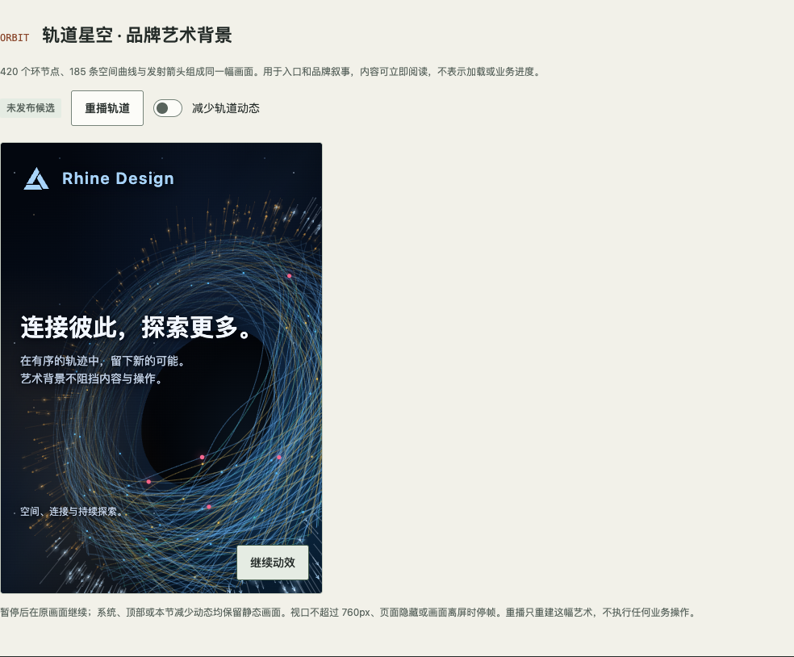

# OrbitBackdrop · 轨道背景

`OrbitBackdrop` 将授权移交的轨道动画作为通用装饰组件维护。Rhine、Arknights 与原始深色共用原版的 420 个环节点、185 条曲线、80 个深度桶，以及相同的投影、轨迹、速度和相位。当前源码候选按用户指定，将 Neo Brutalism 的主题艺术替换为旋转的草莓甜甜圈：粉色糖霜、彩色糖针、烘焙侧面与粗描边。它适合登录、欢迎等入口区域；不包含产品文案、账号逻辑或网络请求。需求与移交记录见 [Issue #8](https://github.com/linhay/rhine-design/issues/8)。

**版本边界：**此组件自 `@linhey/rhine-design@0.6.0` 提供，0.5.0 及以前不包含它。0.6.0 使用固定深色艺术；本页的 `appearance`、三主题线条画法、主题调色板及精简展台属于尚未发布的源码候选，不属于 npm 0.6.0 的能力。采用前核对安装版本与 `components/index.ts`，固定精确版本并提交 lockfile。组件源于 [OrbitBackdrop.tsx](../components/OrbitBackdrop.tsx)，绘制实现在 [orbitRenderer.ts](../components/orbitRenderer.ts)；后者是内部实现，不作为公共 API 导入。

## 使用与契约

```tsx
import { Logo, OrbitBackdrop, Text } from '@linhey/rhine-design';

// 基础组合自 0.6.0 提供，放在现有主题根内。
// 0.6.0 默认深色；当前源码候选默认跟随主题。
export function WelcomeArtwork() {
  return (
    <OrbitBackdrop className="welcome-artwork" style={{ minHeight: 360 }}>
      <Logo decorative />
      <Text as="h1" variant="title">开始新的工作</Text>
      <Text>从这里进入你的工作空间。</Text>
    </OrbitBackdrop>
  );
}
```

| 输入 | 契约 |
| --- | --- |
| `HTMLAttributes<HTMLDivElement>` | 接收容器原生属性，如 `className`、`style`、`id`；宿主负责尺寸、位置和相邻内容布局 |
| `appearance?: 'theme' \| 'original'`（源码候选） | 默认 `theme`：Rhine 与 Arknights 采用主题轨道画法，Neo Brutalism 展示草莓甜甜圈；`original` 在任何主题中都保留初版固定深色轨道。切换风格保留当前暂停状态与动画时间；npm 0.6.0 尚不支持此参数 |
| `reducedMotion?: boolean` | `true` 加强减少动态偏好；`false` 或省略均不能覆盖系统、祖先或环境的停帧条件 |
| `children` | 放入 `.rhine-orbit-content` 内容层，可组合 Logo、标题、正文、表单、动作和页脚，也可用 Surface 分组；宿主 class 控制内容布局，避免遮挡主要艺术或暂停控件 |

组件持有绘制配方、内部类名、样式与暂停状态。宿主通过 `appearance` 选择跟随主题或原始艺术，不复制 Canvas 实现、不另写同用途动画，也不通过覆盖内部样式重建其视觉。没有速度、节点数量、业务进度或任意调色板参数；需要新能力时先在设计系统中补契约与展台。

保留初版深色艺术的源码候选用法如下；npm 0.6.0 直接使用组件即可得到原始深色，无需传入此尚未提供的参数：

```tsx
<OrbitBackdrop appearance="original" style={{ minHeight: 360 }} />
```

Canvas 绝对定位在内容层下方。内容层为直接置于艺术上的文字提供与当前画面相配的前景，原始深色使用浅色前景；普通 Text 与非 icon Logo 继承当前前景，muted Text 沿当前前景降低透明度。不修改宿主颜色 tokens，也不新建或嵌套 `ThemeProvider`。Surface、Notice 等有底色的组件继续使用自己的语义前景，表单与按钮保留宿主主题的前景 / 背景组合。默认内置 Rhine `Button`，在独立控件区域提供“暂停 / 继续”的明确操作。Canvas 为 `aria-hidden` 纯装饰，不接收键盘焦点，不提供进度或业务状态。有效信息仍由普通 HTML 内容表达；动画暂停、减少动态或 Canvas 不可用均不影响内容与业务操作。

## 动效生命周期

下列任一条件成立时停止逐帧调度，保留静态画面：

- 用户主动暂停；
- 系统 `prefers-reduced-motion: reduce`，或 `reducedMotion` 为 `true`；
- 祖先的 `data-rhine-motion="reduced"` 偏好生效（内层跟随系统不覆盖外层减少动态）；
- 当前窗口宽度不超过 760px 时，轨道网络停帧；Neo Brutalism 的主题甜甜圈在窄屏也可播放；
- `document.hidden`、组件离屏或可用绘制尺寸为零。

“暂停 / 继续”使用随当前动作变化的按钮名称，不同时声明 `aria-pressed` 切换语义。“继续”只解除用户主动暂停，不越过其他停帧条件。恢复时沿冻结的动画时间继续，不累计隐藏期间的时间，也不追赶错过的帧。偏好或可见性改变时即时重新判断；窗口调整会以当前冻结时间重绘静态画面。Canvas2D 设备像素比上限为 2，Three.js 为 1.5；卸载清理 rAF、监听器和 observers，离开页面不会继续后台绘制。

Three.js 导入失败、WebGL 不可用或上下文丢失时回退到已有 Canvas2D 甜甜圈，继续遵循同一暂停与减少动态规则。上下文恢复后按当前时间重绘；卸载释放几何、材质、纹理、实例缓存和 WebGL 上下文。Canvas 不可用时保留静态艺术 fallback 与 `children`；Neo Brutalism 主题展示随包提供的静态甜甜圈 SVG。此降级不表示浏览器或页面业务失败，也不以加载提示掩盖缺失的装饰能力。

## 主题与可读性

当前源码候选默认 `appearance="theme"`。Rhine 与 Arknights 在同一完整网络上调整画法，节点数量与位置、曲线连接、投影、轨迹、速度、相位和深度关系保持原版。Neo Brutalism 的甜甜圈是用户后来明确指定的单主题例外，不将该替换扩散到其他主题或原始深色。主题艺术的设计如下：

| 风格 | 线条与节点设计 |
| --- | --- |
| Rhine · 莱茵纸面 | 细实线、空心节点，去除霓虹光晕 |
| Arknights · 战术终端 | 沿原曲线分段的虚线、方形节点与锐利箭头 |
| Neo Brutalism · 橙趣 | 旋转的立体草莓甜甜圈、粉色糖霜、彩色糖针、粗描边与奶油色背景 |
| `original` · 原始深色 | 保留初版深色描线、节点、箭头与光晕 |

`appearance="original"` 保留初版完整画面，宿主主题切换不会改变其画法或颜色。`paper`、`technical`、`donut` 是内部绘制风格，不增加公共参数。甜甜圈优先按需加载内部 Three.js 绘制器，使用有厚度的糖霜、程序生成的烘焙纹理、280 根立体糖针、110 颗糖珠，以及独立环绕的 100 根糖粒和 460 颗细糖尘。约 22.4 秒有效播放时间沿自身环面旋转一圈；与原版共用相机投影（yaw -0.72、tilt 0.22、roll 0.34、透视距离 3.6），不另加摆动。绘制器复用 Orbit 的唯一时钟与生命周期，不创建独立帧循环。Three.js 复用源码候选已有的固定依赖，纹理本地生成，不访问外部模型、纹理或 CDN。

甜甜圈与原轨道还共用构图：中心位于画布宽度的 62%、高度的 57%，比例为 `min(width × .66, height × .39)`；不另作居中或给主体扣除底部控件高度。Canvas2D 与 Three.js 共用环半径 `.84`、管半径 `.34` 和糖霜厚度 `.022`，将主体外缘与开口收至原轨道的范围。相机一致并不意味着模型大小自动一致，需同时校对主体几何尺寸与实际截图。

Canvas 与 CSS 使用对应风格的艺术调色板。切换主题或 `appearance` 时重绘当前动画时间对应的画面，不解除暂停，也不触发重播；切换到甜甜圈再切回轨道也保留时间。减少动态等停帧条件下仍以冻结时间重绘。原始画法与主题样式分别维护，避免修改主题时意外改变原版。

两种模式下，控件、语义容器、独立操作区与外框都继续使用完整宿主主题 tokens；不能只改控件的前景而保留白色背景。直接叠加的提示和透明 quiet 操作继承当前内容前景；quiet 的有底色 hover / disabled 状态保持宿主配色，键盘焦点使用当前文字颜色的内描边。可按产品分组需要使用 Surface，不以它作为控件可读性的前提。宿主应提供足够的布局空间，避免正文与主要曲线重叠，也不能遮住暂停入口。

轨道动画不替代 `Progress`、`Skeleton` 或 `Logo`。登录提交、校验失败、数据刷新不重播动画；动画时间不决定业务何时就绪。仅为重播装饰而更换 key 时，将 key 限于 `OrbitBackdrop`，输入状态由重播边界外的宿主持有，不能因重播重置表单或其他业务状态。

## 真实组件展台与验收

当前源码候选的本地展台 `http://127.0.0.1:18309/#orbit` 复用公开组件，主画面展示纯艺术，保留可直接操作的暂停 / 继续入口。画面外提供「跟随主题 / 原始深色」、局部重播与手动减少动态，并继承系统和全局偏好；下方组合控件示例默认折叠，展开后查看直接叠加的表单、按钮和 Surface。重播只重新挂载装饰组件，不重执行业务动作、不清空外层内容。此条目与 `/#motion` 的 12 组交互配方、`/#startup` 的启动编排分别维护。

验收应覆盖以下行为；本节是验收要求，不代表浏览器检查已执行：

1. Rhine、Arknights 与原始深色保留原版 420 个环节点、185 条曲线及完整透视和运动关系；同一尺寸与动画时间下核对节点位置和曲线路径一致。Neo Brutalism 主题独立检查甜甜圈实际旋转、糖针随表面运动、糖霜与烘焙面层次；切换到原始深色必须回到原轨道。不能只检查单张截图或颜色差异。
2. 鼠标与键盘可暂停 / 继续；暂停时画面冻结，恢复不跳过冻结期间的时间。
3. 系统、显式 prop、祖先偏好均可中断动画；将 `reducedMotion` 设为 `false` 不能覆盖系统减少动态。
4. 检查 400 / 520 / 880 宽度、200% 缩放和三套主题，确认窄窗轨道静态、甜甜圈可播放，控件可见、焦点可读且无横向溢出。组合 TextField、主 / 次按钮及 Surface，检查输入文字、placeholder、默认 / hover / disabled 状态和容器内 Text 的前景与背景。
5. 页面隐藏、离屏、零尺寸时停帧，恢复及 resize 行为一致；卸载无残留调度或监听。
6. Canvas 不可用时仍显示静态艺术和内容；业务表单、请求与路由不依赖动画。
7. 源码候选分别检查三主题的 `theme` 艺术与不随主题改变的 `original` 艺术；暂停后切换主题和模式，确认 CSS 背景与 Canvas 画法同步、原网络位置与时间不变且暂停状态保留。展开组合示例检查前景与控件，主画面保持完整可观看。

宿主接入后仍需验证自己的页面布局与业务交互；单元测试、展台检查不等于宿主原生平台或完整辅助技术验收。

### 2026-10-24 Three.js 细节与粒子验证（未发布）

用户追加要求更多细节与粒子，并允许使用 Three.js。新增绘制器与共享工作区现有候选一起通过 `npm test -- --maxWorkers=2 --testTimeout=20000`：26 文件、202 项测试；其中 5 项直接验证 Three.js 的确定性时钟、两个尺寸与四个时间的原版投影一致、上下文恢复以及正常/部分初始化失败后的资源释放。类型检查、Vite 生产构建及产物检查通过。基础 Canvas 保持测量尺寸，立体画布覆盖其画面；GPU 设备像素比上限为 1.5。

固定生产构建的真实 Chromium 通过 20 项交互检查及 6 组布局检查（400 / 520 / 880px × 100% / 200% CSS zoom），无页面横向溢出，暂停控件始终在画框内，错误日志为 0。连续 1.8166 秒有效时间观察到 109 次绘制帧及 11 个不同像素摘要；Space 暂停后 GPU 不再绘制，模式往返的最后一帧像素一致。检查涵盖三种减少动态来源、离屏、模拟页面隐藏、主题往返、重播保留草稿、上下文丢失/恢复、WebGL 或模块失败降级、迟到导入与卸载清理。页面隐藏采用 `document.hidden` 与事件模拟；CSS zoom 不能替代浏览器原生 200% 缩放，未据此宣称原生缩放验证。此增强仍为本地源码候选，未发布到 npm 或部署至宿主生产。

### 2026-10-24 当前候选与验证边界（未发布）

用户随后指定仅将橙趣主题替换为旋转草莓甜甜圈。当前候选加入内部甜甜圈画法，复用原有时钟和状态管理；单元测试分别验证其他主题的完整原网络与甜甜圈的窄屏播放、暂停及模式往返、草稿保留和动效生命周期。甜甜圈与原版共用相机投影，基准坐标测试锁定原版倾角与透视，移除额外摆动。此轮 `npm test -- --maxWorkers=2 --testTimeout=20000` 通过 24 文件、191 项测试（Orbit 18 项），类型检查、构建及产物检查通过。首轮默认 5 秒限制曾使完整轨迹比较超时，未出现断言不符；保留该失败记录，复跑只放宽单项超时，没有改弱断言。总数包含并行工作区其他组件。共享工作区后续加入立体渲染路径后，补跑 `OrbitBackdrop` 与 `OrbitDonutThree` 两文件的 23 项测试全部通过，构建重新通过；相机测试逐点核对立体投影与原版投影，并验证倾角不随时间摆动。

真实浏览器在本地构建预览中核对：甜甜圈窄屏实际帧推进，Space 暂停、模式往返及 resize 往返后像素一致；400 / 520 / 880px 均保留画面且无横向溢出，200% CSS zoom 无横向溢出。手动和系统减少动态均冻结画面，原始深色仍为轨道；Canvas 不可用时显示静态 SVG。最终立体画面另以真实截图检查：暂停后完全一致，在相同焦点下切换原版再返回也完全一致，错误日志为 0。Canvas 验收需等待尺寸/效果同步后的绘制帧，不能把 DOM 状态已更新等同于画布像素已更新。

大小与位置对齐后，相关两文件 24 项测试及构建重新通过：逐点核对三个尺寸、四个时间的原版中心、比例与倾角，同时检查模型外缘和开口范围。构建预览在 400 / 520 / 880px 与 200% CSS zoom 下无横向溢出，WebGL 画布保持布局尺寸，页面错误日志为 0；本地预览实际帧继续推进，模式往返后的冻结截图一致。

提交收口时，仅提取 Orbit 相关文件与共享文件中的对应段落，排除共享工作区的中子星、紧凑账号等在途改动。在该独立暂存快照中执行全量检查：20 个测试文件、164 项测试、类型检查、生产构建与产物检查全部通过；此计数与前述共享工作区的阶段验证分别记录。

以下为甜甜圈替换前的验证历史：用户当时要求保留原版几何结构和运动关系，仅重新设计三主题线条。`npm test -- --maxWorkers=2` 通过 18 个文件、149 项测试，其中 Orbit 15 项包含两个时间点的完整路径、绘制顺序、箭头及节点标记中心一致性；`npm run build` 的类型检查、Vite 构建及 CSS / SVG 产物检查均通过。测试总数包含共享工作区其他组件，不能与此前同为 149 项的已撤回方案混作同一份证据。

本地真实浏览器验证三主题 × 400 / 520 / 880px 与 200% CSS zoom 均有画面、无页面横向溢出；CSS zoom 不等同于浏览器原生缩放。暂停后主题往返和 resize 往返的像素一致；`original` 在 Rhine / Arknights 宿主之间切换时像素一致。Space 恢复播放后像素推进，手动减少动态后画面冻结；系统减少动态时状态为 `reduced`，艺术画面仍保留。

生产构建另经本地 Vite preview 的真实浏览器检查：三主题均显示对应画法，切换保持 `paused` 且无横向溢出；固定相同画幅时，`original` 从 Rhine 切换到 Arknights 的 Canvas 像素摘要完全一致。开启系统减少动态后，多次独立采样的像素摘要一致，静态艺术仍存在。该生产预览页的错误日志为 0，此结论不扩展到共享开发环境。当前仍为未发布源码候选，不代表宿主业务或原生辅助技术验收完成。

此前仅换色阶段的 144 项测试，以及后来已撤回的独立稀疏几何方案的 149 项测试、构建与浏览器检查，仅为对应历史实现的技术结果。独立几何方案未获设计接受，已撤回；这些结果均不能用于证明当前保留原网络的主题画法已通过验证。

### 2026-10-24 初始源码候选验证

`npm ci`、`npm run check` 通过：65 项测试（轨道新增 10 项）、TypeScript 类型检查、展台生产构建及 CSS / SVG 产物检查。轨道测试覆盖完整节点绘制、DPR 上限、暂停时间冻结、系统 / prop / 祖先偏好、隐藏 / 离屏 / 窄窗 / 零尺寸、resize、Strict Mode 清理、Canvas 失败降级和重播保焦点。逻辑绘制尺寸使用 CSS client size，避免 CSS zoom 后暂停或 resize 改变线宽；真实浏览器验证固定画幅在 zoom 1→2→1 及 resize 后静态像素保持一致。

本地 Chromium 真实展台通过 19 项检查：跨时间像素采样可见轨道运动；Space 键暂停 / 继续；系统、显式及祖先减少动态与恢复；三主题 × 400 / 520 / 880 宽度的静态 / 播放和无横向溢出；200% CSS 缩放与局部重播。另验证真实滚动离屏后像素冻结，返回可见区域后继续。页面错误为 0。页面隐藏与卸载由单元测试覆盖，不宣称已验证真实业务入口或原生平台。

0.6.0 发布审阅发现初始候选的局部前景 tokens 会污染嵌入控件；现已移除这组覆盖。非 icon Logo 使用默认写法并继承所在内容的前景，无需按艺术底色另设 `theme="dark"`。上述初始截图与 19 项浏览器证据不代替修正后的组合控件验证。

合并 0.5.0 应用能力并准备 0.6.0 后，重新执行 `npm ci` 与 `npm run check`：16 个测试文件、136 项测试、TypeScript、展台构建及 CSS / SVG 产物检查全部通过。真实展台已加入 Surface 内的正文、提示、TextField 与主 / 次按钮，供发布时单独验证三主题可读性。

仓库外生产构建验证进一步发现：动画帧可先于媒体 `change` 事件观察到减少动态，此时只停帧会留下过期的播放状态。帧检查现复用同一同步路径，更新按钮与状态并清空上一帧时间；不增加停帧后的轮询。新增该事件顺序与恢复不追赶的回归后，16 个测试文件、137 项测试（`--maxWorkers=2`）、类型检查及构建通过。

以下截图仅展示初版固定深色展台；当前主题模式与精简展台的验证见本页各阶段记录。


