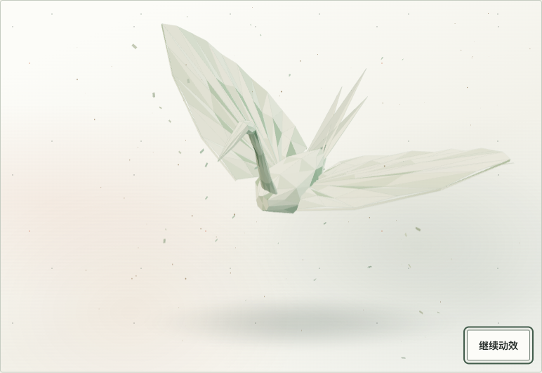
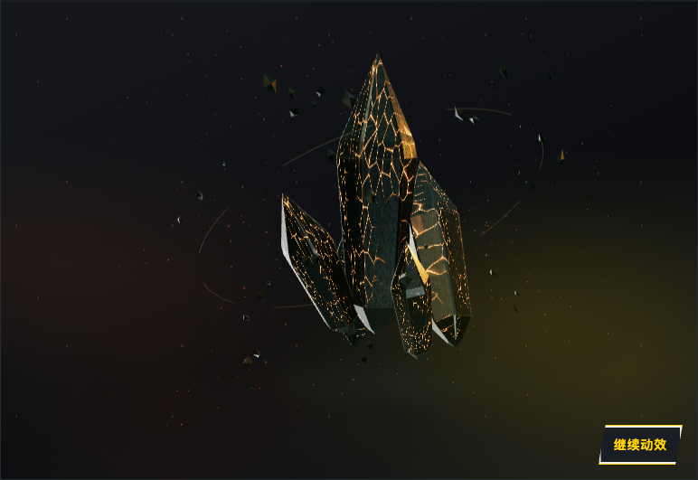
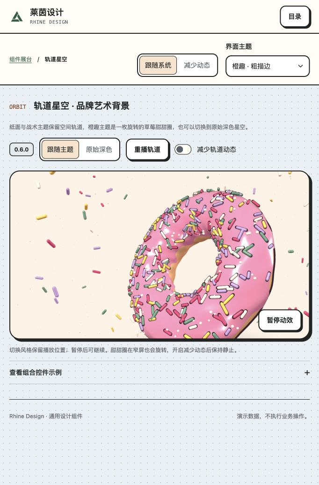

# OrbitBackdrop · 主题艺术背景

`OrbitBackdrop` 是带暂停控制的装饰组件。0.8.0 根据主题展示折纸鸟、源石晶簇或草莓甜甜圈，也可通过 `appearance="original"` 保留初版深色轨道。它适合欢迎、登录和品牌展示区域，不表达业务进度，不包含账号逻辑或外部资源请求。移交来源见 [Issue #8](https://github.com/linhay/rhine-design/issues/8)。

**版本边界：**基础组件自 `@linhey/rhine-design@0.6.0` 提供；`appearance` 与三套主题物品需要 0.8.0。0.6.0 默认固定深色轨道，升级后默认跟随主题；需要保持旧视觉时显式使用 `appearance="original"`。固定精确版本并提交 lockfile。

## 使用与契约

```tsx
import { Logo, OrbitBackdrop, Text } from '@linhey/rhine-design';

export function WelcomeArtwork() {
  return <OrbitBackdrop style={{ minHeight: 360 }}>
    <Logo decorative />
    <Text as="h1" variant="title">开始新的工作</Text>
    <Text>从这里进入你的工作空间。</Text>
  </OrbitBackdrop>;
}
```

| 输入 | 契约 |
| --- | --- |
| `HTMLAttributes<HTMLDivElement>` | 宿主负责尺寸、位置、相邻内容布局与可访问名称 |
| `appearance?: 'theme' \| 'original'` | 默认跟随主题；`original` 固定初版深色轨道，切换保留播放位置与暂停状态 |
| `reducedMotion?: boolean` | `true` 加强减少动态；`false` 不能覆盖系统或祖先偏好 |
| `children` | 普通 HTML 内容层，可组合表单、按钮、Logo 与 Surface；不得遮挡暂停控件 |

组件持有绘制算法、内部类名、主题配方和暂停状态。没有任意速度、粒子数、业务进度或调色板参数。宿主不复制绘制器、不嵌套 ThemeProvider，也不通过覆盖内部样式重建视觉。内部文件 `orbitRenderer.ts`、`orbitObjectsThree.ts`、`orbitObjectMaterials.ts`、`orbitDonutThree.ts` 不作为公共 API 导入。

## 四套画面

| 风格 | 物品与细节 |
| --- | --- |
| 莱茵 · 纸面 | 折纸鸟：578 个实际三角折面、暖白纤维纸纹、扇形褶皱与叠层双翼、立体细颈与三片尾羽、弧线飞行与振翅转弯、42 片随行纸屑与 120 颗微尘 |
| 战术终端 | 悬浮源石晶簇：五块不同姿态的倒角晶体、程序矿物纹理、琥珀裂纹、48 块环绕碎片、420 颗余烬与断续约束环 |
| 橙趣 · 粗描边 | 草莓甜甜圈：烘焙纹理、立体糖霜、280 根糖针、110 颗糖珠、100 根环绕糖粒、460 颗糖尘与奶油色背景 |
| `original` | 完整初版轨道：420 个环节点、185 条空间曲线、80 个深度桶、箭头、光晕与原始配色 |

折纸鸟以舒展的翼面与轻盈的飞行呼应莱茵纸面主题；源石晶簇采用坚硬、暗色的矿物质感。原始模式不随主题改变。

莱茵物品在飞行中连续变形成纸蝴蝶：原有 578 个三角折面保持连接，鸟颈收为蝶首、尾羽重塑为触须与腹尖、左右翼展开为四瓣蝶翼；折痕与纸纹随顶点移动，不更换模型或交叉淡化。42 秒有效播放周期为纸鸟 4 秒、折叠变形 14 秒、纸蝴蝶 6 秒、折回 14 秒、纸鸟 4 秒。变形依次收翼、松开折痕、展开为近乎平面的中间纸形，短暂停留后重新折出新形态；翼根、内侧折线与翼尖以独立时间窗依次松开、重新折起，相邻动作错开约 0.8–1 秒；纸面由内向外展平，外缘延后跟随，鸟颈与尾羽绕根部打开。中途暂停扑翼，让折纸动作清晰可见，完成后平滑恢复；蝶形阶段转为较快的扑翼。暂停和减少动态同时冻结形态、翼拍与飞行位置，恢复后接续当前折叠进度。Canvas2D 使用同一组对应顶点与变形函数；静态 SVG 保留纸鸟初始形态。

主题物品按需加载 Three.js，环境反射与表面纹理均在本地生成，无模型下载、CDN 或外部纹理。种子固定，运动由唯一的有效播放时间决定；物品、振翅、纸屑、碎片和着色器共用宿主时钟。切换主题复用已创建的绘制器，未激活的画布隐藏并停止绘制。异步导入完成时复核当前主题及挂载状态。

甜甜圈保留已校准的原版相机与构图：yaw -0.72、tilt 0.22、roll 0.34，透视距离 3.6；中心位于宽度 62%、高度 57%，缩放为 `min(width × .66, height × .39)`。环半径 .84、管半径 .34、糖霜厚度 .022，约 22.4 秒有效播放时间转一圈，不额外摆动。折纸鸟从略高的角度展示宽翼与折面，沿 14 秒弧线往返、起伏并侧倾转弯，双翼以约 2.4 秒周期振动，振幅随飞行阶段变化；纸屑沿稍早的飞行位置散开。Three.js 与 Canvas2D 共用姿态函数，全部运动使用宿主有效播放时间，暂停或减少动态时保持同一姿态。晶簇按竖向轮廓取景。两者都为底部操作区留空间。

## 动效与降级

下列条件停止逐帧调度：用户暂停，系统/prop/祖先减少动态，页面隐藏，组件离屏，或尺寸为零。`original` 在窗口不超过 760px 时还会静态降级；三套主题物品在窄屏继续播放。恢复时沿冻结时间继续，不追赶隐藏期间的时间。静态状态调整尺寸或主题仍会重绘当前帧。

Canvas2D 像素比上限 2，WebGL 上限 1.5。Three.js 无独立 rAF；卸载取消调度、断开 observers，移除监听器，释放几何、材质、纹理、实例缓存、renderer 与 WebGL 上下文。

WebGL 不可用、模块加载失败、运行时绘制失败或上下文丢失时，回退到对应物品的 Canvas2D 插画。上下文恢复后沿当前时间继续。Canvas 也不可用时，三主题各展示随包提供的静态 SVG；原始模式保留 CSS 星场。所有降级保留内容与可用业务操作。

## 内容与可读性

Canvas 是 `aria-hidden` 装饰，不接收键盘焦点。有效信息由 HTML 内容表达。内置 Button 提供随动作变化的“暂停动效 / 继续动效”名称，不额外声明 `aria-pressed`。

直接置于原始深色艺术上的正文与非 icon Logo 继承浅色前景；主题模式继承宿主文本色。Surface、Notice、输入框和有底色按钮保留完整宿主 tokens。透明 quiet 操作和提示继承内容前景，焦点使用内描边；不覆盖全局颜色变量。

## 真实组件展台与验收

入口为 `/#orbit`。主画面只展示艺术与暂停控制，外侧提供主题/原始模式、重播与减少动态。控件组合示例默认折叠，展开可验证直接叠加的表单和 Surface。重播只重挂装饰组件，保留输入草稿和按钮焦点。

本轮 Chromium 检查通过 53 项交互检查及 18 组布局（3 主题 × 400/520/880px × 100%/200% CSS zoom），无横向溢出，按钮位于画框内，页面错误为 0。逐帧采样验证了三种物品随有效播放时间产生不同像素。暂停和主题往返保持像素；三种减少动态、离屏、模拟隐藏、上下文丢失/恢复、失败降级、迟到导入、重播草稿与卸载均通过。此处为本地开发构建证据，正式包消费及线上发布身份以发布记录为准。

CSS zoom 不能替代浏览器原生缩放；`document.hidden` 事件模拟不能代表真实后台切换；未据此宣称原生端、任意 SSR 或宿主业务已验收。历史 0.6.0 轨道和甜甜圈单主题测试只对应当时源码，不代替本次三物品验收。






