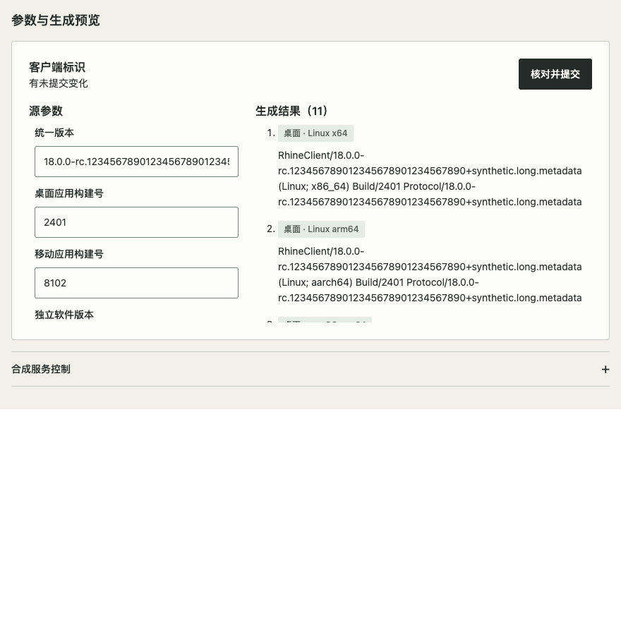
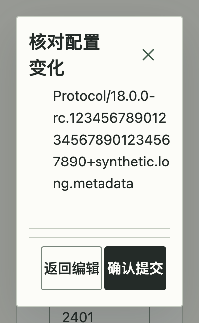

# 少量参数与生成预览

源码组合示例：`#parameter-config`；独立验收入口：`?fixture=parameter-config`。关联 [#115](https://github.com/linhay/rhine-design/issues/115)，以[结果常显纠正](https://github.com/linhay/rhine-design/issues/115#issuecomment-6514401290)及[四参数消融决定](https://github.com/linhay/rhine-design/issues/115#issuecomment-6514499322)取代旧正文的结果默认折叠、独立引擎覆盖建议。[四字段与双区滚动纠正](https://github.com/linhay/rhine-design/issues/115#issuecomment-6515733599)及[解释与身份标签纠正](https://github.com/linhay/rhine-design/issues/115#issuecomment-6515807157)进一步取代旧例的低频字段折叠与预览身份文字标题。

这是现有组件与 HTML 语义的合成配方，不新增公开组件、生成器、规则引擎或包版本，不声称新 npm API 已发布。只使用合成固定模板；真实参数依赖、模板正确性、鉴权、并发控制和持久化归宿主。系统、架构与终端固定只属于本例，不能据此认定旧生产配置可以无损迁移，也不要求所有产品合并独立版本。

## 输入与布局

- 四个文本参数直接展开：统一版本、无法可靠推导的桌面/移动应用构建号及独立软件版本。四字段不使用折叠，也不保留专为失败展开的 ref/状态。没有独立引擎覆盖、系统编辑字段或对应状态和分支。
- 十个客户端结果使用同一完整版本，独立软件只使用自身版本，共十一条。版本允许完整预发行与构建元数据，空值或非法格式不生成有效结果；预览明确显示“待校验”。
- 主标题与提交在两栏上方，两区标题也位于对应滚动区外。内容容器达到 42rem 时左输入、右结果约 39%/61%，窄容器上下排列，DOM 顺序保持输入先于结果。配置与预览各自一个命名、可聚焦的滚动 region，高 18rem 且最多 50svh；使用 overscroll containment。实际 PageDown 分别滚动而不移动另一栏、标题和提交，Tab / Shift+Tab 可离开；预览不嵌套第二滚动。
- 完整结果常显，十一条使用现有中性 Badge 展示完整身份名称，仅代表身份，不表示继承状态。不保留常驻机制说明、逐项继承徽标或重复请求头；错误、未提交和失败/冲突反馈保持可见。长字符串换行，末项及标签完整可达。请求头只在完整提交差异中展示；影响范围与数量保留在提交确认。

复用 TextField、Stack、Inline、Badge、Notice、Button、Dialog、Disclosure 与有名称的 region。无须增加组件 API。此配方与[模板驱动设置](TEMPLATE_SETTINGS.md)分工不同：后者编辑与选择已保存模板、映射和批量对象，本例编辑少量源参数并核对派生文本，不复制模板工作区。

## 草稿、核对与结果

1. 编辑只改变草稿与即时预览。dirty 按实际参数与当前基线比较，无变化时提交禁用。主题/宽度改变不丢草稿。
2. 提交前校验全部四参数。只在失败提交时聚焦首个错误，浏览器将其滚入配置区可见范围；输入过程不抢焦点。
3. 确认 Dialog 默认只列实际参数 before/after 与受影响结果数量；完整结果及请求头差异按需展开。取消或 Escape 回到原动作，草稿保留。
4. 确认捕获已核对快照；busy 与同步 pending guard 防重复。模拟服务明确返回成功后才更新基线并显示已保存。失败保留草稿与确认内容，提供重试。
5. 冲突状态属于宿主，关闭/重开确认仍须保护。读取合成新基线保留草稿、关闭旧确认，再打开核对新 before/after；不把“读取”算作提交。
6. 本例关闭确认取消模拟计时器；卸载也清理。迟到完成不得写入新编辑。真实宿主需取消请求或忽略过期响应，并根据服务端事实确认最终状态。

合成服务控制和完整差异的 Disclosure 关闭内容均不得进入实际 Tab 顺序；字段没有关闭态。普通、系统减少动态、手动减少动态都需走相同校验/失败/成功/取消路径，不通过禁用退出规避异步清理。

## 验证入口与边界

- `npm test -- tests/ParameterConfig.test.tsx`：草稿、校验、真实差异、失败重试、冲突与取消清理。
- 先 `npm run build`，对生产预览 `?fixture=parameter-config` 运行 `scripts/check-parameter-config.js`。矩阵覆盖三主题、400/520/880、100/200% CSS zoom、短屏、长版本、实际内框/末项、两区实际 PageDown 独立性及标题/提交位置稳定、Tab 正反向退出、服务控制关闭 Tab 顺序、错误归焦、身份标签与三种动态偏好。`?probe=clip` / `?probe=inputs-clip` 分别将右/左区设为 overflow:hidden，正常检查应 PASS，两个反例应分别命中对应 PageDown 无法滚动。
- `scripts/check-parameter-config-shell.js`：真实展台主题/宽度切换保留同一输入节点和草稿，导航卸载清理已观察的模拟请求计时器。
- 固定候选 tarball 在全新消费者安装，逐文件核对 Git 与制品，构建相同示例并复验。源码展台、候选安装、npm 发布、真实产品接入分别记录。

合成异步结果不证明真实服务；Chromium 与 CSS zoom 不证明原生网页缩放、其他引擎或读屏语音。本任务不修改消费产品、不升级既有依赖、不发布 npm。

2026-10-30 四字段与双区滚动纠正：集成主线后的 62 文件 / 462 项测试、类型及生产/评审构建通过；源码生产 Chromium 156 在上述 21 组布局/短屏与三种动态偏好中通过。实测左区 PageDown 增量 60–68、右区 252–268 CSS scrollTop，另一栏及区外标题/提交保持位置；正反向 Tab 可退出、错误直接归焦、十一身份标签与完整差异末行可达。左右 overflow:hidden 反例分别命中对应 PageDown 不滚动。固定候选与全新公开入口消费者、精确源码和制品身份见本次纠正 PR；不将历史 448 项或旧候选摘要重复用于本轮。

2026-10-30 PR119 历史验证（低频折叠版本，不证明本轮纠正）：Node 24.21.0，Chromium 156；60 个测试文件、448 项测试及构建通过。上述三主题宽度/缩放 18 组，另加三主题 400×648、200% CSS zoom 短屏，共 21 组；正常/系统减少动态/手动减少动态的同一路径均通过。最小实际字段宽 144px，最小短屏正文高 274px；实际 PageDown 滚动与末项/末行可达。注入 overflow:hidden 的裁剪反例按预期失败于 PageDown，不计为正向 PASS。原始初次失败保留在本地证据，角色查询和多文本节点的测量修正不冒称产品修复。纳入列表组合主线后的首次全量检查有两项既有测试超时，同修订定向及全量重跑通过，根因未确认。候选源码与固定制品身份由对应 PR 绑定；最终集成、主线 CI 与关闭验收另行核对。

