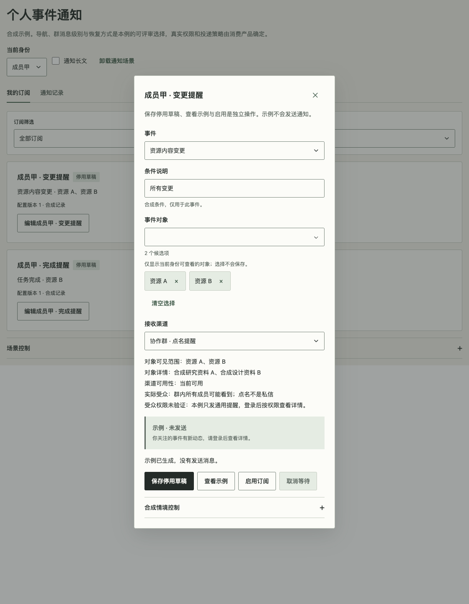

# 个人事件通知组合

对应 [#146](https://github.com/linhay/rhine-design/issues/146)。普通成员配置权限内事件是已确认目标；以下导航、消息级别、暂停与恢复方式是**可评审的合成示例选择**，不代表消费产品已经确认，也不是所有产品必须采用的策略。真实展台 `#personal-notifications`，隔离入口 `?fixture=personal-notifications`。这是未发布的源码配方，复用 Dialog、Tabs、ListFilterBar、RemoteMultiSelect、Select、Notice 等公开组件，不增加公共权限、订阅、调度或投递 API。

## 身份与三个范围

成员使用“我的订阅”和按需阅读的“通知记录”；管理员全局规则和渠道管理单独呈现。合成成员甲可见 A/B/D、成员乙可见 C/D，管理员区不展示成员个人草稿。身份切换卸载旧编辑器、候选查询和请求，不将旧身份草稿带入新身份；返回成员重新加载该身份的合成初始状态。真实产品可按身份持久化，但必须重新校验权限、隔离缓存与旧响应。隐藏按钮不是鉴权，后台对每次查询和写入重新确认身份与授权。

| 事实 | 本例表达 |
| --- | --- |
| 可以查看的事件对象 | 当前身份的对象候选与已选范围；失权后的名称、详情和派生示例不得继续展示 |
| 可以使用的接收渠道 | 渠道被授权且当前可用；对象可见不意味着拥有渠道使用权 |
| 实际能看到消息的受众 | 个人通知箱与群成员不同；群内点名不等于私信，也不证明群内所有成员有对象权限 |

本例对受众权限未验证的群渠道只生成通用提醒，详情需登录后再按权限查看；这是一项局部可评审策略，不是通用消息内容限制。消息预览始终标“示例 · 未发送”，只生成示例，不发出消息、不改变已读状态。

## 编辑、保存与启用

居中 Dialog 按事件、该事件所需条件、对象、渠道、受众与示例组织；短表单不增加多步向导。候选搜索、分页、取消、选中回显和过期结果校验由宿主负责。展台通过可取消的合成响应演示这些关系，选择或关闭候选不会保存整个表单。

- **保存停用草稿**：确认后保存配置并保持停用；本例已启用配置再次保存也明确停用，按钮文案说明后果。无对象或无渠道仍可保留草稿，不伪造候选或有效执行。
- **查看示例**：根据当前有效草稿生成合成文本，与保存和启用分别等待；字段或权限变化后清除旧示例。
- **启用订阅**：必须有当前有效对象和渠道，并且已保存当前草稿。缺失时显示字段内原因并聚焦首个无效字段；存在未保存编辑时要求先保存。只有合成响应确认后显示“启用意图已确认”，不据此表示已投递、已读或外部工作已排空。

列表最多两个常显筛选，本例仅一个。配置版本、范围、暂停原因和通知时间位于相关内容区；操作行仅放操作。保留既有主题、焦点与动效，不通过缩字号、固定内容高度或裁切错误来压缩。

## 失效、冲突与恢复

权限改变时，先从当前草稿、已保存摘要、候选缓存、搜索词、选中标签和示例中移除失权对象，再取消旧查询与操作。保留有效选择及其他条件/订阅草稿，只给出“部分范围不再可用”等安全说明；错误反馈也不能复述旧对象信息。全部范围或渠道失效必须暂停有效执行。

本例采用更保守的局部恢复选择：任一已选范围失效即暂停，并要求重新保存、明确启用；恢复权限只更新可选范围，不恢复已被清除的选择、不自动提交或启用。真实服务如何暂停执行、撤销授权与处理在途投递由宿主确认，前端清理不能证明后端已停止。

保存冲突保留草稿，显示持久错误，核对后再显式保存。取消等待、关闭 Dialog、身份切换、权限变更和卸载都中止本地等待、释放合成响应计时器；代次与范围检查拒绝忽略 AbortSignal 的迟到结果。关闭保留当前身份的编辑草稿；身份切换清除整个旧工作区。取消等待不等于撤销真实外部写入：真实写结果不确定时按[自动化配方](AUTOMATION_SETTINGS.md)先回读，不盲目重写。本例的取消会中止尚未完成的合成操作，不模拟真实持久化服务。

通知记录独立呈现“投递结果未知”。读取失败或取消后，未知和失败持续可见；恢复入口只读取同一记录，不重新发送。渠道已受理与收件人已读分别表达，缺少已读证据就保持“未确认已读”。曾成功读取后再失败或取消时，“上次确认受理”及其合成时间仅作历史；当前状态仍为未知，不用旧成功覆盖本次缺口。读取中保留稳定按钮与焦点，不在响应完成时抢走用户已经移开的焦点。真实观测有效期与旧记录可见权限还应遵守[对象生命周期配方](OBJECT_LIFECYCLE.md)，过期或失权不能因界面重开而变成新鲜成功。

## 验证入口与边界

`preview/NotificationGallery.tsx` 与 `preview/notificationRecipe.ts` 仅包含合成宿主组合。`npm test -- tests/Notifications.test.tsx` 验证草稿、权限清理、冲突、取消、迟到响应、身份隔离和投递读取；`scripts/check-personal-notifications.js` 对生产构建执行真实浏览器验证。合成情境控制用于重复撤权、恢复、冲突和读取失败，不进入消费产品。

验收按精确候选记录：四主题、400/520/880 局部容器、短屏、长名称、100/200% **CSS zoom**、真实键盘和焦点、正常/系统/手动减少动态，以及固定 tarball 全新安装后的内容与行为。通过源码/JSDOM不等于通过生产浏览器；截图只证明静态状态。原生网页缩放、读屏语音、其他引擎、真实鉴权/投递服务与原消费产品另列实际结果，不能由该矩阵外推。源码候选不表示 npm 发布或消费升级。

合成群渠道示例：对象、渠道和受众分别呈现，预览常标“示例 · 未发送”。截图只说明静态状态，交互与动态由上述入口验证。

