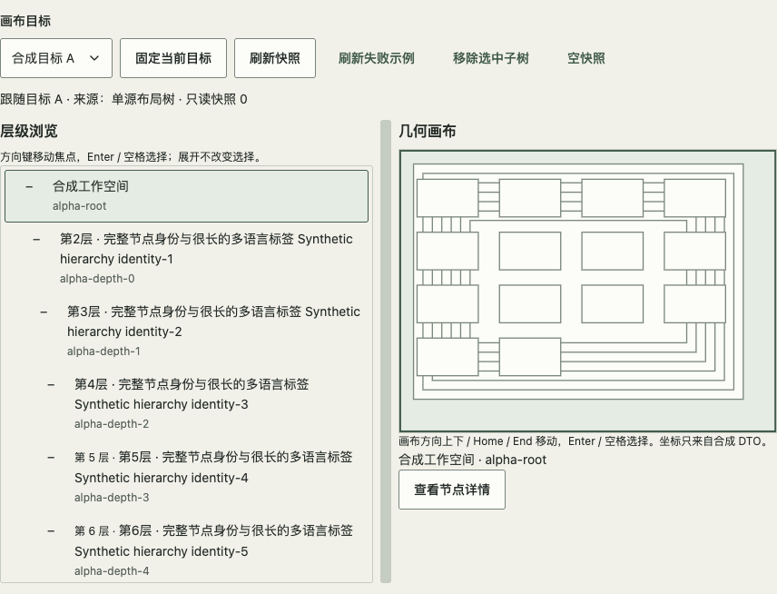

# 常驻层级浏览树与外部画布

对应 [#117](https://github.com/linhay/rhine-design/issues/117)，本页是 **Web 组合配方**。公开基础组件 + 语义 HTML 已能完成此例，不新增 Tree 公共导出；TreeSelect 仍用于浮层选择，不代替常驻浏览。npm 0.11.3 不包含本配方；源码、固定候选、正式 npm 和原消费替换分别验收。

真实展台 `#resident-tree`，直接测试入口 `?fixture=resident-tree`。完整可复制示例为 `preview/ResidentTreeRecipe.tsx` 与 `preview/resident-tree.css`，外壳为 `preview/ResidentTreeGallery.tsx`。它们随候选包提供，属于示例代码而非新增稳定导出。迁移时在消费项目维护与数据契约对应的组合，不导入库的 preview 私有路径充当生产 API。

## 所有权与数据

- 宿主提供只读 DTO：同一快照内唯一、稳定的 `id`，可空 `parent`，完整 `label` 和与几何画布同坐标系的 `bounds`。示例要求父先于子、无环、父节点存在。真实宿主负责转换、校验、来源与权限，不让显示组件查询设备或执行命令。
- `selected`、`hovered`、`expanded` 分开受控。展开/折叠只改展开集合；方向移动只改焦点。Enter/Space 或树行选择才改变 selection。画布和树共用 DTO id；选中画布节点时展开其祖先以显露选中项，鼠标 hover 不抢焦点。
- 固定目标与跟随目标分离：固定后画布目标切换不改变树；此时明确说明暂停跨目标联动。恢复跟随后装载当前目标。单源布局树与单源可访问树分别标识，不能伪装成两个独立来源。示例的来源标签仅描述合成快照。
- 刷新中保留旧快照；失败显示常驻原因，保留旧树与选择并允许重试。首次无快照时分别表达加载/空/错误。目标切换与卸载取消旧请求；真实请求还需 AbortController 和请求代次保护。

## 树语义、键盘与焦点

键盘与所有权依据 [WAI-ARIA APG Tree View](https://www.w3.org/WAI/ARIA/apg/patterns/treeview/)。显式层级元数据不代替父子 group 所有权；DOM 检查也不代表真实读屏验收。

示例采用嵌套 `role=tree` / `treeitem` / `group`，每项同时明确 `aria-level`、`aria-posinset`、`aria-setsize`，分支有 `aria-expanded`，选择有 `aria-selected`；每个展开父项直接包含子项 group，不能只用视觉缩进表达层级。折叠子项实际卸载。树项无嵌套可 Tab 控件，单一项 `tabIndex=0`，其他项 `-1`；空树由容器接受唯一停靠。DOM id 由实例前缀和稳定 DTO id 组成，刷新不换 key。嵌套 treeitem 的外框包含整个子树，不能把 wrapper 获焦当成行已可见：先 preventScroll 聚焦，再将对应可见行滚入树的实际内框；Tab 再进入、Home/End 与删除恢复都要验收可见行。

| 键 | 行为 |
| --- | --- |
| 上/下 | 在可见节点间移动焦点，不改变选择 |
| 右 | 折叠分支展开；已展开分支移到第一个子项 |
| 左 | 展开分支折叠；否则移到父项 |
| Home/End | 第一个/最后一个可见节点 |
| Enter/Space | 受控选择当前节点 |

删除当前焦点节点/折叠祖先时，先取仍可见的最近父项，再回退首项；全部移除回到空树容器。目标切换回到新树首项。离树时将停靠点恢复到仍可见的选中项（无选择则首项）；外部 pointerdown、显式 blur 与窗口失焦释放焦点归属。只在树原来持有焦点时实际归焦；用户已移到宿主操作区或画布时只更新停靠位置，不抢焦点。外部删除仍需宿主同步受控选择；示例删除子树后选父节点。

## 布局、反馈与生命周期

长标签与 id 自然换行，不截断必要身份。深层节点将视觉缩进限制为三档，但仍显示真实层级文字与完整 ARIA 层级。树有独立有界滚动，必须验证最后一项、文字实际行片段和焦点环可达，不能只断言整页没有横向溢出。较窄容器将树与画布上下排列，隐藏的分隔条退出 Tab 顺序；宽容器用可键盘操作的 separator。

画布以 `(clientX - actualRect.left) / actualRect.width` 和对应 y 比例映射 DTO 坐标；不能把 client 坐标混用 offsetWidth。分隔条每次使用相邻 pointer client 位移除以工作区实际 rect 宽度，并更新起点；不把累积总位移反复叠加。pointerup/cancel/lostcapture 都结束拖动。

更新标记同时有「已更新」文字与一次 1 秒动画，1 秒后清理。系统/手动减少动态关闭动画但保留同样的静态文字提示与清理路径。再次刷新重启本次标记，目标切换与卸载清理计时器。本例不提供 paused；若消费产品提供暂停，必须同时冻结动画与寿命计时器，并按剩余寿命恢复。

详情复用公开 Dialog/Tabs/CopyButton，Portal 沿用唯一 ThemeProvider。主题与尺寸更新不加入树/详情 key，不重建实例或丢失当前详情页签；Escape 返回触发器。复制必须等待实际 Clipboard/宿主异步结果，失败保留草稿与重试；示例只有合成 JSON，不执行草稿。非活动详情页签的按钮不得进入实际 Tab 顺序。

## 从评审到消费

同一组合先在独立 review 评审，再接回宿主；接回检查宿主工具条、Portal 祖先和滚动容器是否遮挡状态或焦点。单 ThemeProvider 原位更新；正式构建登记 fixture 目录，验证普通模块可构建、引入 fixture/review 的反例会被 production guard 拒绝，见[评审契约](REVIEW_TOOL.md)。展台通过不代表宿主包装后也通过。

固定候选由 `scripts/prepare-resident-tree-consumer.mjs` 在全新目录安装，复制候选内的示例并仅改为公开包导入；逐文件核对安装包与同一 tarball/源码。对该独立生产构建运行 `scripts/check-resident-tree.js`。CSS zoom 与原生浏览器缩放、真实设备/读屏、真实服务分别记录；此合成浏览器验收不证明后者。

上游交付包括契约、真实展台与固定候选。npm 发布不在本次范围；原消费临时 adapter 由其 owner 在后续授权升级中固定实际制品、核对 DTO/键盘/焦点/失败/动效等价后替换，不因 issue 关闭强制升级。
