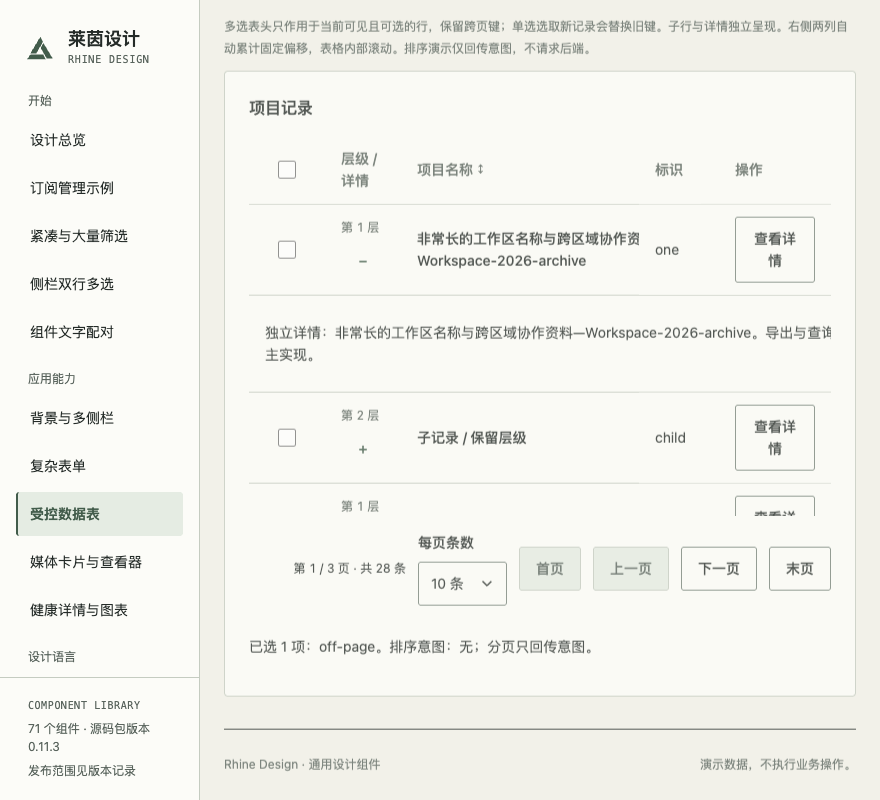
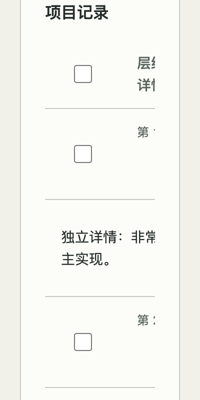

# DataTable 选择列验收（#172）

本次只修复选择列重复长标签导致的行高；不改变选择状态模型、普通 Checkbox 或固定列策略。#173 独立跟踪固定列超出实际容器预算的遮挡。候选未发布 npm。

## 已验证

- PASS：Node 24，607 项单测、类型、展台构建、CSS/SVG 和 review 包检查。
- PASS：生产 Chromium 156，五主题 × 880/100%、520/100%、400/200% CSS zoom × compact/comfortable × 单选/多选，共60组。真实 Tab/Space/Radio ArrowDown、focus-visible 样式、44×44 CSS px 标签外侧点击、完整可访问名称、mixed/禁选、跨页键和回页、加载/禁用/错误旧数据、普通 Checkbox 可见标签均验收。
- PASS：正常、系统减少动态、真实展台“减少动态”三条选择路径，记录实际偏好值与焦点。
- PASS：恢复可见长标签的定向反例触发行高与标签尺寸断言，无脚本异常代替检出。脚本为 `scripts/check-table-selection.js`；默认矩阵使用展台“固定右侧列”关闭固定，以独立验证本项。保留固定列的880px默认对照另测。
- 基线：main `adbce8f1f174cda7b76b3c8af2cab97b283442fe` 的现构建中，首行883px、选择标签858px高、文字宽14px。候选同场景首行91px、标签44×44px、隐藏文本1×1px。行内名称保留，实际行高可随内容及主题变化。

## 失败与边界

- 原始脚本首先遇到执行环境无全局 URL；改为在页面中读取地址。下一轮60组中25个跨页初始键断言失败：同一含 hash 地址导航保留了前一轮单选状态。使用独立场景 URL 后60组通过；未修改组件来迎合断言。
- 初轮手动动态检查误用 `reduce` 而非现有 `reduced`，该项不计 PASS；最终改为真实操作展台单选控件，并重新验证三种偏好。原始记录保留。
- 首次安装使用本机默认 Node25，出现 engines 警告；随后在允许的 Node24 下重新全新安装及运行全部工程检查。
- #173 的固定列遮挡尚未由本项解决，窄屏选择列和名称的最终组合可达性需接续该独立修复；不能将本项无固定列矩阵外推为 sticky 全场景通过。
- SKIPPED（明确排除）：原生网页缩放、实际读屏语音和其他浏览器引擎矩阵。DOM/浏览器可访问名称及键盘是本轮独立可验证范围，不冒充语音或原生缩放。
- N/A：真实后端、npm 发布、消费产品升级、UIKit。展台数据均为合成数据。

固定包、全新安装及最终修订身份随 PR 交付证据记录；这些结果与上述源码构建分别核对，不把旧包等同于新候选。
