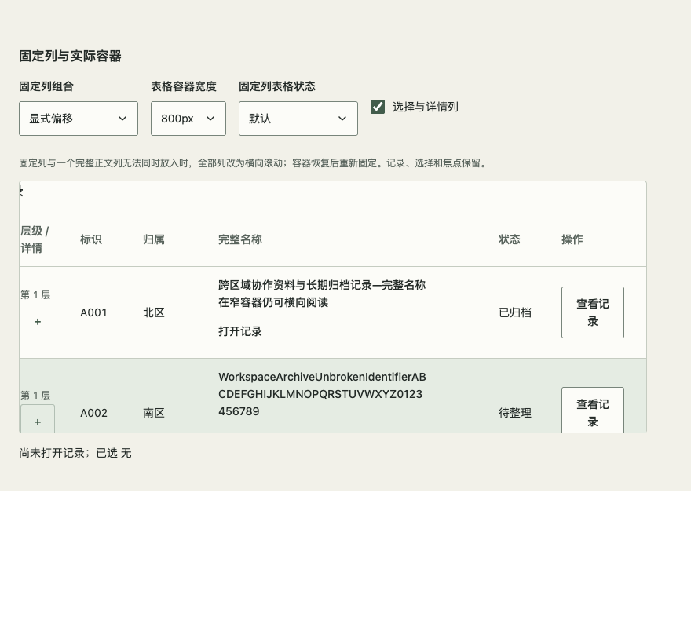
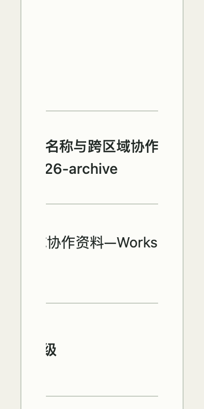

# 固定列的容器预算与验收（#173）

`sticky/stickyOffset` 仍由宿主声明，组件复用实测列宽判断是否可固定。声明 width 只是自动表格布局的下限；只用窗口断点或宿主声明值不能可靠覆盖实际内框、内容与偏移变化。此修复没有新增公共 API。

左右固定带分别取最大 `offset + 实测列宽`，再预留最宽非固定业务列或选择/展开辅助列。总量超出滚动区 clientWidth 时整组取消列固定，恢复空间后重新启用；不隐藏字段、缩字号、猜测列优先级或卸载行。所有业务列固定时也要保留辅助列空间。测量只取当前 table 的直接表头，空字符串列 key 按属性存在处理。

固定带同步作为水平 scroll-padding。仅当表格配置了固定列，焦点进入时就近滚动当前目标；容器尺寸或固定策略变化时再次就近显示既有焦点，不更换焦点。原生 Tab 可能将只露出几像素的目标视为可见，因此仅有 scroll-padding 不足以保证完整目标可命中。

## 可复现检查

`#advanced-data` 保留原表格并增加“固定列与实际容器”合成展台；`?fixture=table-sticky` 复用同一组件供独立包验证。

- `scripts/check-table-sticky.js`：五主题 × 1280/880/520 CSS100 与400 CSS200 × 单左、单右、双侧、多固定、显式offset、全部业务列固定，共120组。起/中/末真实命中、两行全部145个非空白业务字符逐一滚动露出、原生Tab/Enter、完整焦点目标及焦点环（含既有战术 inset shadow）分别断言。
- 同一表格内容宽度保持不变，实际容器由798缩为108再恢复，验证默认/刷新旧数据/失败旧数据的固定切换及同一焦点节点；另在原展台完成正常/系统/手动减少动态下的选择及动态收缩。
- `scripts/check-table-selection.js` 继续60组单/多选回归；新增第二表格后，状态断言明确匹配第一表格的“已选…项”摘要。
- `?stickyProbe=force-pin` 在窄框强制恢复右固定，须触发取消固定、主体命中或文字可达断言；异常不算反例通过。
- 单测覆盖完整正文预算、两侧显式offset、容器观察、辅助列、节点/焦点保留与清理、嵌套DataTable和空key。将测量选择器改回后代表头时，测试明确拒绝第五个嵌套表头；改回truthy key判断时，测试拒绝错误的0px而非100px偏移。

## 保留的失败与证据边界

- 原主线/172候选在400 CSS200的原展台，110局部CSS px容器被固定操作列持续覆盖；起/中/末采样均不能命中名称。可逆取消固定后中段名称恢复命中；880对照固定行为保持。
- 第一轮120组文字可达通过，但4个真实键盘遮挡、3个尺寸变化后焦点出窗；144个战术主题焦点断言只查outline而漏掉既有inset shadow。分别修实现与检查，不混作同一原因。
- 第二轮120组剩1个neo/520/左固定失败：60px按钮只露出约3px时Tab未横滚，中心仍在容器外。已增加焦点进入的nearest滚动并保留定向复现。
- 初轮检查估计了错误字符数和110px外框值；实际145字符、带边框内框108px。后续按实际内容与内框断言，同时在固定表宽下验证容器观察。原始结果保留，不用scrollWidth存在替代可读性。
- 工程过程的展台类型推断、JSDOM缺scrollIntoView、Testing Library不支持exact选项及普通merge冲突均保留；修正类型/测试模拟与合并双方内容，不降低行为断言。

最终源码、固定tarball、全新安装及生产矩阵结果绑定对应PR的精确修订；前轮失败不被后轮覆盖。逐字符可滚动到达不表示长行同时完整显示，也不表示所有像素已检查。

SKIPPED（范围排除）：原生网页缩放、真实读屏语音和其他引擎完整矩阵。N/A：真实后端、npm发布、消费产品升级与UIKit。所有记录为合成数据；不安排人工步骤代替自动验收。
