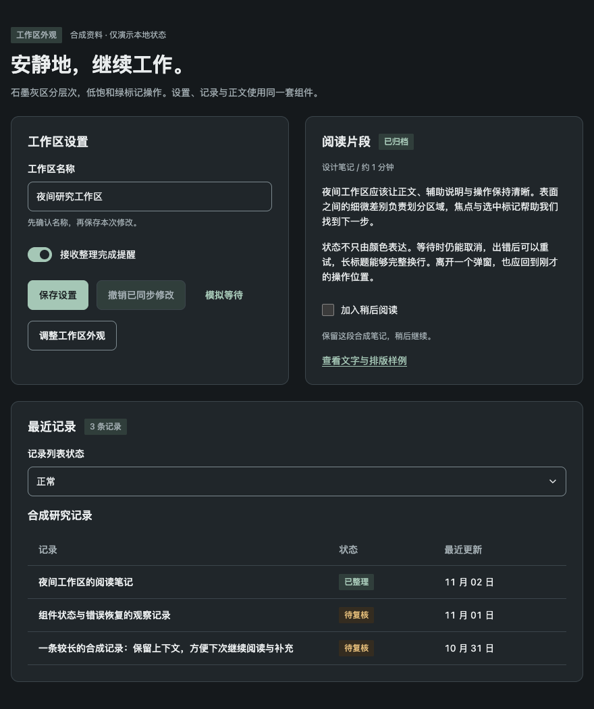

# 石墨主题候选验收

2026-11-02，基于 `effe49881154bae999f0057761a7136b016297e1` 的石墨增量候选。Node 24.21.0、Vite 8.3.4、Chromium 156.0.8078.80；合成数据，使用生产构建。源码包版本仍为 0.11.3，不表示 npm 已包含本候选。

| 项目 | 结果与范围 |
| --- | --- |
| 既有四主题基线 | PASS：32 场景、1440 颜色样本 PASS、64 禁用 EXEMPT |
| 五主题扩充矩阵 | PASS：40 场景、2080 PASS、80 EXEMPT、0 pageerror；新增危险按钮默认/hover/焦点及选择卡 hover/selected |
| 最终石墨颜色 | PASS：8 场景、416 PASS、16 EXEMPT，400/520/880 × CSS zoom 1/2，加系统/手动减少动态 |
| 状态与交互 | PASS：最终展台 8 场景，保存错误/重试/等待取消、禁用、列表加载/失败重试/空态、键盘勾选、Dialog 内五主题切换、同节点草稿与焦点保留 |
| 外壳与布局 | PASS：6 组真实外壳宽度/缩放组合；同节点主题切换、无文档/工作区横溢、文字片段边界；表格键盘横滚至末列可见 |
| 减少动态 | PASS：系统与手动模式走完同一交互路径，另验浮层 animation none / transition 0s |
| ThemePicker | PASS：6 组合，五张实际 960×600 图片、键盘选择、禁用、图片失败、弹窗切换与草稿保留 |
| 单元与类型 | PASS：69 文件、571 tests；类型检查通过 |
| 构建与包 | 初轮 npm run check 与最终生产构建通过；独立固定包生产消费入口 6 组合通过，覆盖新 CSS 导出、五图、键盘切换、Portal 与同节点草稿。最终文件摘要另存任务证据清单 |

颜色脚本读取实际计算样式并合成透明背景。最终石墨代表样本的普通文字最低约 4.876:1（选择卡辅助文字），必要非文本信息最低约 4.250:1（Textarea 边界），原始比值比较前不四舍五入。禁用与 busy 按现有检查契约标 EXEMPT，不能把 16 项豁免加入达标数量。

七项颜色反例 text/alpha/focus/texture/luminance/opacity/display 均检出预期 FAIL 或 UNMEASURED，场景完整执行且无 pageerror；没有用超时证明检出。最终石墨交互另以 focus/overflow 两反例分别命中归焦轮廓缺失与文档横溢。

初次脚本失败保留：SelectionCard 的 sr-only checkbox 被可见 label 拦截，改用真实 label；空态“暂无记录”与 select option 同名，改为限定空态正文。二者不是产品颜色缺陷。初次窄屏截图另发现嵌套卡片导致标题单字竖排：最终展台改用普通 Checkbox，并移除无选择任务的表格选择列。主题 CSS 与公共组件在该收紧前后逐字一致；全量颜色矩阵和最终展台/石墨复验分别记录，不混称同一构建。

旧四主题 CSS、tokens 及四张静态预览与基线逐字一致。新增预览来自同一 ThemeSample，摘要见 `components/assets/theme-previews/manifest.json`。原始日志、各轮失败、逐文件摘要与候选补丁保存在本地任务证据目录；公开 issue 只记录脱敏摘要。

边界：这是所列代表组件的验收，不是全库 WCAG 认证。CSS zoom 2 不等于原生浏览器 200% 缩放；其他浏览器引擎、读屏语音、UIKit、真实服务与消费产品升级均未覆盖。提交及主线合并状态以关联 PR 为准；固定本地包接入不冒充 npm 发行。

初次提交准备仅调整 README 的五主题清单与交付阶段措辞；组件、展台、验证脚本和图片与本节实测候选逐字一致。固定包摘要对应先前的验收制品，未以文档修订重写历史制品。

PR #156 审阅增量：石墨和通用 picker 检查先等待五个预览完成加载或失败，再要求恰好五张已加载的 960px 图片，避免失败移除 img 后空数组 every 假通过。`?graphiteProbe=preview` / `?pickerProbe=preview` 阻断石墨图片，均明确命中 `five theme previews not loaded`，不是以超时作为成功证据；正常石墨 8 场景/6 外壳及 picker 6 组合重跑通过。共享视觉更新重建五图，单主题更新只重建对应图并核对其余图片不变。此增量只改检查脚本和文档，运行代码与图片不变。
