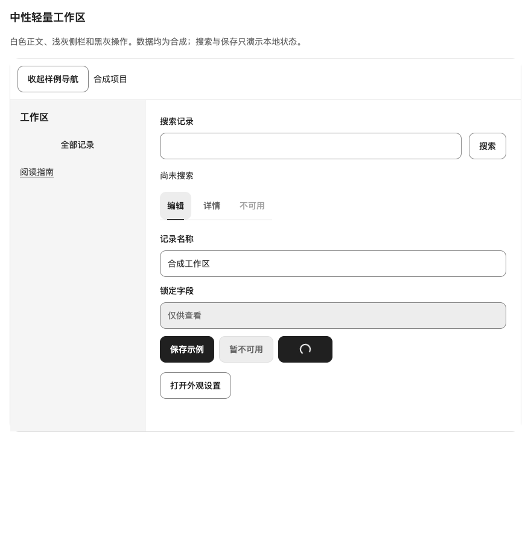

# 中性主题验收（2026-10-29）

范围为 #98，基线 `8c23eea20d55962dc50cae381abc5815ca04677e` 加本 PR。Node 24、Chromium、合成数据。完整候选 commit、固定 tarball SHA-256 与全新安装文件对照记录在对应 PR；包字段仍为 0.11.3，不是同号 npm 新发行。

- PASS：全量 54 文件 / 409 测试、TypeScript、展台和双评审示例构建、包入口检查。
- PASS：生产预览四主题 × 400/520/880 × CSS zoom 1/2，24 个组合。错误草稿保留、disabled、Tabs 键盘和隐藏内容 Tab 排除、Dialog 范围与主题切换、Portal 草稿与关闭归焦、focus 轮廓和 44px 操作目标。另验系统/手动减少动态，Dialog animationDuration 均为 0s。
- PASS：ThemePicker 四张真实 960×600 图片、键盘选择、禁用、加载失败及 Portal 切换。三张原主题重新截图与原文件逐字一致；新 neutral 图片及全部源摘要保存在 assets manifest。
- PASS：定向反例将 Dialog 圆角强制置零，`check-neutral-theme.js` 返回 `pass:false` 并命中 `neutral surface incorrect`；正常矩阵返回 `pass:true`。
- 保留失败：首次浏览器脚本把 Node URL 当成 CLI 全局，报 ReferenceError；随后隐藏面板 role locator 等待超时，改为保留原 DOM handle；ThemePicker 初稿的 `has` locator 重复嵌入 dialog 导致六项 TIMEOUT，改为相对定位。均属已定位的验收脚本问题，原输出保留，不算产品通过记录。
- SKIPPED：原生浏览器缩放、人工读屏、其他浏览器引擎及真实后端；CSS zoom、JSDOM 与合成保存不能替代这些证据。

可重跑 `scripts/check-neutral-theme.js` 与 `scripts/check-neutral-picker.js`（Playwright CLI 当前页面指向生产预览）。前者从 `?neutralProbe=radius` 启动可触发反例；原始 JSON 的 pass/rows/errors 必须读回，CLI 退出码不能代替结果。旧大矩阵 `check-settings-theme.js` 已扩展到四主题，本轮未将其全量执行计为 PASS。

源码合并与 Pages 更新不等于 npm 发布或产品升级；消费项目的隔离样稿例外仍需其 owner 另行核对固定包与删除局部实现。issue 由主控按剩余消费条件决定关闭。
